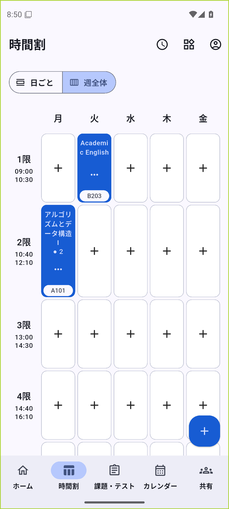
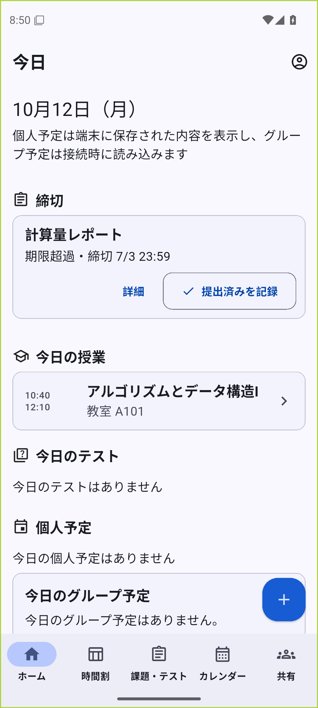
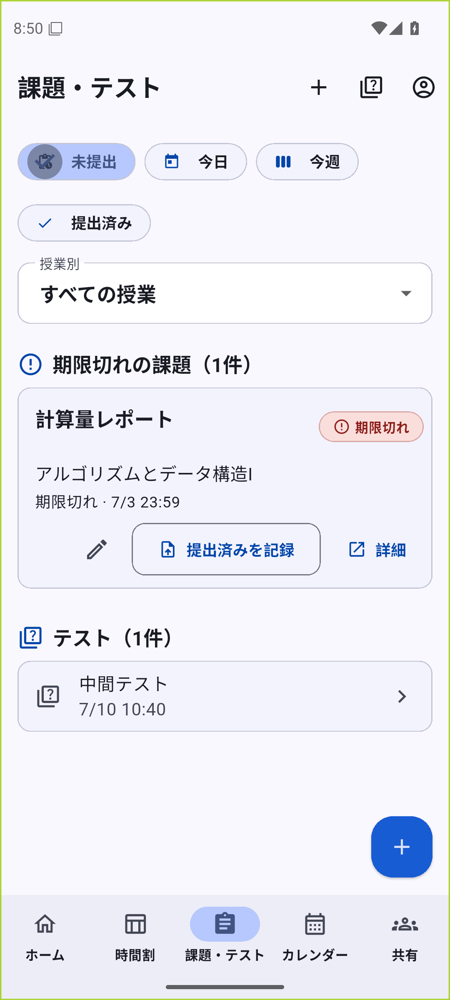
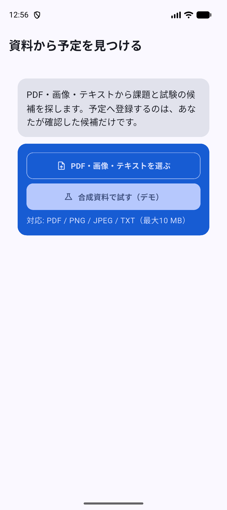
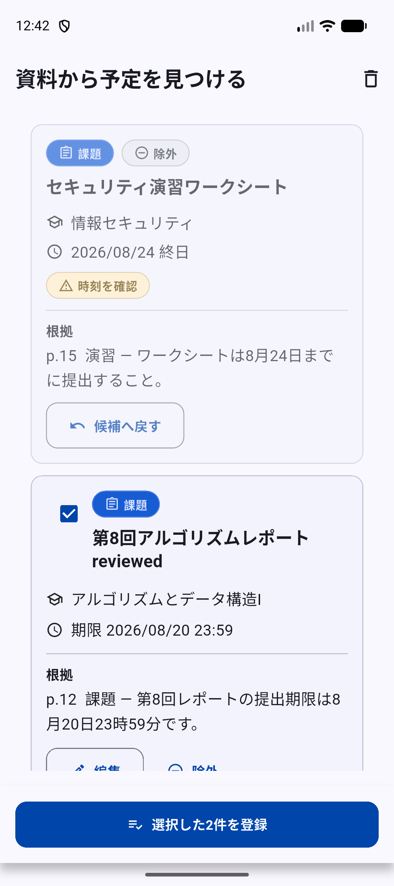

# University Schedule App

大学生向けに、時間割・課題・試験・予定・共有をまとめて管理するFlutterアプリです。

**v1.0.0 — Portfolio / Source Release。** ソースと再現可能なローカルデモの公開版です。本番サービスやストア配信の完了を意味しません。公開履歴はv1.0から管理しています。

- 時間割を週・日表示で確認し、授業から課題や試験へ進めます。
- 課題の締切と提出状態、試験、繰り返し予定と一回だけの例外を管理します。
- Driftに保存し、送信待ちの変更・再送・競合をSupabaseとの同期として処理します。
- 友だち・グループへの共有をPRIVATE / BUSY_ONLY / TITLE_ONLY / FULLで制御します。許可されない詳細はRPC側で返しません。

**技術:** Flutter / Dart、Riverpod、go_router、Drift / SQLite、Supabase Auth / PostgreSQL / RLS / RPC / Realtime、Next.js / React、Android Kotlin、iOS Swift / WidgetKit。Realtimeは再取得を早める補助です。

## 実画面

<p align="center"></p>

<p align="center">


</p>
<p align="center">


</p>

Androidエミュレーターの実画面です。架空データを使用し、資料抽出はdeterministic fake adapterです。実AIや本番接続の実績ではありません。[撮影の由来と制約](docs/assets/README.md)

## 最短のローカルデモ

Flutter **3.44.4** / Dart **3.12.2**、実行用**JDK 21**、Android SDK、Python 3を用意します。リポジトリ直下からPowerShellで実行してください。AndroidのJava/Kotlinコンパイル対象は17です。

```powershell
Set-Location apps/mobile
flutter pub get --enforce-lockfile
dart run build_runner build --delete-conflicting-outputs
flutter build apk --flavor staging --debug `
  --dart-define=APP_ENV=local `
  --dart-define=APP_DEMO_MODE=true `
  --dart-define=APP_DEEP_LINK_SCHEME=unischedule-staging
```

出力は`apps/mobile/build/app/outputs/flutter-apk/app-staging-debug.apk`。`staging`はAndroidのflavor名で、この例はlocal/demoとして起動します。デモに実アカウント・Supabase・AI key・`.env`は不要です。依存物の取得にはネットワークを使います。自分で用意したデモ用端末では、同じdefineを付けた`flutter run -d <device-id> --flavor staging`で起動できます。

起動後は合成メール（例：`demo@example.test`）を入力し「メールで続ける」でデモに入ります。local/demoではfake Authを使用し、メール送信や外部ログインは行いません。

## 実装と検証

[今回の検証と再現コマンド](docs/TESTING.md)を参照してください。既存の通常unit/widgetスイート、共通domain、Android JVM/Robolectric、管理画面、Edge、SQL/権限を層ごとに記録します。公開ソースのCIは[Actions](https://github.com/ayumu-homma/university-schedule-app/actions)で確認できます。コマンド成功から実機や全製品の受入を推測しません。

2026年9月29日の開発版にはFlutter 802成功・1スキップ、domain 91成功、Android JVM68成功の記録がありました。これは過去の証拠です。今回の公開版の結果とは区別します。

Android接続E2E、物理Android/OEM、iOS/macOS、ホスト型Auth/SMTP/OAuth、実AI/通知provider、production署名、本番運用・ストア配信は未受入です。APK/AABはReleaseに添付しません。資料取り込みのfake成功を実AI成功として扱いません。

## ソースの見どころ

- [アーキテクチャ](docs/ARCHITECTURE.md)：ローカル保存、outbox、アカウント境界、公開範囲の投影。
- [要件とソース](docs/MVP_TRACEABILITY.md)：実装・テスト・外部受入の対応。
- [セットアップ](docs/SETUP.md)：依存取得、生成、デモ、管理画面。
- [API](docs/API.md)、[セキュリティ](docs/SECURITY.md)、[公開前確認](docs/PUBLIC_RELEASE_CHECK.md)。
- [CHANGELOG](CHANGELOG.md)、[ROADMAP](ROADMAP.md)。

```text
apps/mobile/             Flutter、Android/iOS連携、unit/widget・接続テスト
apps/admin/              Next.js管理画面、削除・ポリシーWeb導線
packages/shared_domain/  公開範囲・空き時間・繰り返し等の共通ルール
supabase/                migration、RPC/RLS、Edge Functions、SQL/APIテスト
scripts/                 検証と手動受入の入口
```

## 権利と制作

ポートフォリオとしてソース公開。**オープンソースライセンスは未付与**です。GitHub規約に基づく閲覧・forkとOSS再利用許諾は区別します。[第三者のライセンス・権利表示](THIRD_PARTY_NOTICES.md)は維持しています。大学公認や実ユーザー運用実績を主張していません。

要求・優先順位・仕様判断を利用者が提示し、Codexが実装・テスト・調査・文書整備を支援しています。内部会話・実行ログ・個人用設定は公開資料に含めません。次の開発では、実ユーザー検証を通じたUI/UX改善と必要性を検証した3D表現を検討します。
