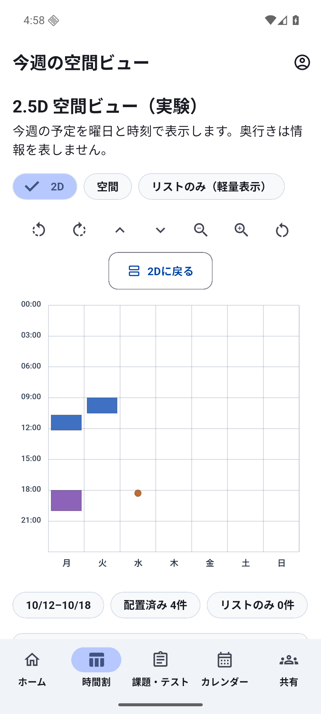
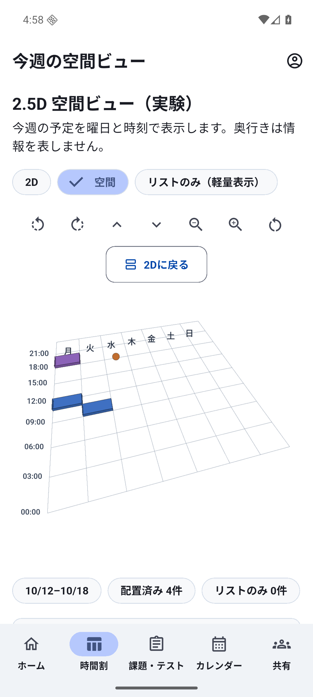
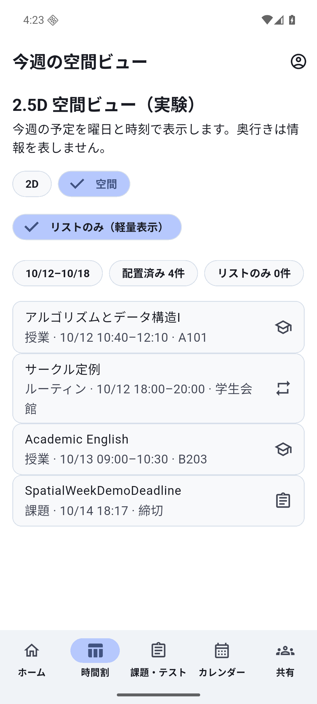
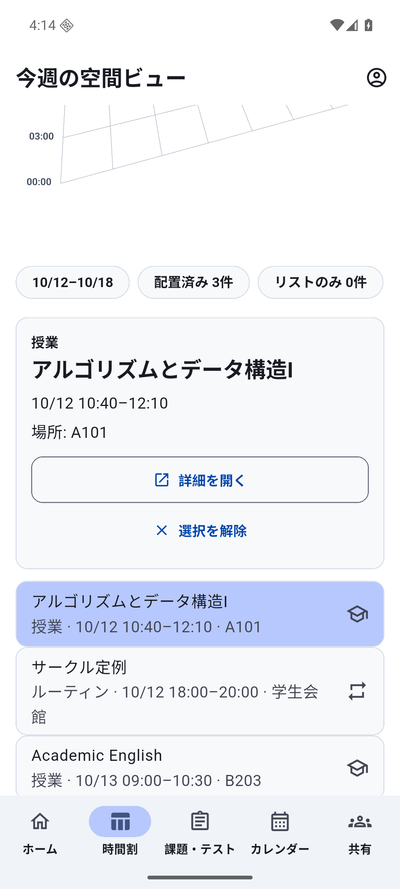
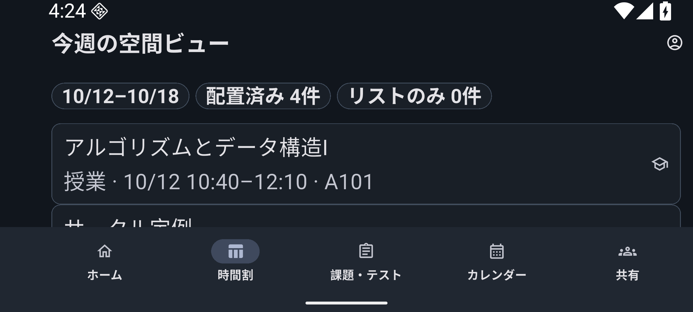

# Spatial Week — 3D_EXPERIMENTAL

This optional source experiment follows v1.1.0. The normal timetable remains the default; the package version stays 1.1.0+2 until a separate stable release is justified. This branch does not claim a stable v1.2.0 release or a proven improvement in student lookup speed.

## Purpose and renderer choice

The hypothesis is that changing viewpoint can make overlapping classes, personal events and deadline concentrations easier to inspect. A campus model would require positions absent from the data. Giving urgency an invented height would add an ambiguous quantity. The experiment therefore uses the actual day/time week with fixed decorative block thickness.

The implementation is **geometric 2.5D**: perspective projection, clipped cuboid faces, rotation, zoom and hit selection drawn with Flutter CustomPainter. Day and Japan time are the two data axes; thickness carries no additional data. It is interactive geometry, with no scene engine, automatic spin, textures or external assets.

Alternatives checked against primary package documentation on 2026-10-12:

- Flutter CustomPainter: uses the existing Flutter dependency and license inventory; adds zero package dependencies and native rendering engines. Android behavior is verified in the recorded test environment; iOS device behavior needs separate acceptance. Choosing it does not establish performance superiority over other engines.
- [flutter_cube](https://pub.dev/packages/flutter_cube): Apache-2.0, version 0.1.1, an older OBJ-oriented package with flutter/path/vector_math dependencies. Listed platform support is not proof of compatibility with this app's Flutter 3.44 runtime. No installed binary-size or frame comparison was made.
- [three_js](https://pub.dev/packages/three_js): MIT, version 0.3.0 at inspection, ANGLE on native platforms and WebGL2 on web, with multiple component dependencies and platform requirements. Documentation mentions renderer evolution and some Android loader limitations. Actual transitive/binary size, iOS/Android app compatibility and frame performance were not measured because it was not installed.

## Data and interaction contract

The view reads the existing local models through Riverpod. Courses are restricted to the owner and active term. Course-linked assignments/exams use that same active-course set; standalone owned assignments/exams remain visible. Personal events use the owner's primary calendar and exclude group-bound records. This is a personal-week experiment, not a replacement for the full calendar or sharing projections.

Existing CalendarProjectionService expands course/routine occurrences and exceptions; JapanTime determines the Monday-to-Sunday week. Timed intervals split at Japan midnight. A deadline is a point marker, not a fabricated busy duration. All-day records and courses with unset/invalid period times stay in the equivalent list with explicit labels. Submitted deadlines retain the existing calendar projection policy.

- Switch between the same-data 2D projection and perspective view; the normal timetable is available through navigation.
- Drag to orbit; pinch or labelled buttons zoom; labelled rotation/tilt controls and reset support keyboard operation.
- Tap a visible surface or its list row to select. Drawing and hit testing use the same ordered projected surfaces. Dragging does not select an entry.
- Read the complete title, time and location in the list or selected card, then open the existing detail route. The viewer has no edit/submission action. Existing detail screens keep their normal capabilities.
- Use list-only mode for lower drawing load. At most 160 valid segments are materialized; additional segments remain in the complete list and the canvas reports the omitted count.

The full owner/university/term/year/primary-calendar identity keys view state. Context changes discard selection, camera and retained callbacks. Loading/error states do not render previous data. Viewing, rotating, zooming and selecting must not modify canonical rows or outbox work.

## Reproduce the opt-in source experiment

Use the ordinary local/demo command with the additional compile-time flag:

```powershell
Set-Location apps/mobile
flutter run --flavor staging `
  --dart-define=APP_ENV=local `
  --dart-define=APP_DEMO_MODE=true `
  --dart-define=APP_DEEP_LINK_SCHEME=unischedule-staging `
  --dart-define=APP_ENABLE_SPATIAL_WEEK=true
```

Open the timetable's experimental-view button. Ordinary builds omit the flag, keep the entry hidden and redirect a direct experimental route to the timetable. They add no experimental schedule subscription, ticker or metrics callback. The equivalent list is the semantic interaction surface; the decorative painter is excluded from semantics. Controls use named actions, 48dp targets and normal focus behavior. No automatic motion runs.

## Acceptance and comparison

Functional acceptance passed: default-off routing, projection and context isolation, paint/hit agreement, camera bounds, list/selection/detail interaction, keyboard/semantics, 360/412dp, tablet/landscape, 200% Japanese text and reduced motion. The full normal Flutter suite passed 876 tests across 146 files, with three unchanged optional-fixture skips. Real Drift integration checks verify no viewer/outbox mutations, live event updates and selection removal. Independent review repairs added actual semantics tap actions and fitted the default camera to the whole week. Screen-reader node availability does not establish TalkBack end-to-end usability.

The separate integration-test harness uses an isolated synthetic in-memory Drift dataset and fixed clock. It compares a warmed journey through the **same equivalent list**, selection, existing detail and Back, with three paired trials in alternating order. Mode setup occurs outside the window; this is not a geometric lookup-speed comparison. First viewer entry after fixture setup and orbit/zoom are separate windows; first entry is not cold process launch. Individual engine FrameTiming records are deduplicated and selected by `startFrameNumber < frameNumber <= endFrameNumber`, captured from PlatformDispatcher.frameData in boundary post-frame callbacks. Presentation timestamps remain separate metadata; they are not FrameTiming.vsyncStart. Missing identifiers are unmeasured. A two-second wait allows late batches to arrive but is not a formal delivery-completeness acknowledgement. Build, raster and total-span milliseconds are distinct; their reciprocals are not hardware FPS. Scenario elapsed time is paced by test pumps, not estimated user time or application latency. See [Flutter performance guidance](https://docs.flutter.dev/perf/ui-performance) and [FrameTiming](https://api.flutter.dev/flutter/dart-ui/FrameTiming-class.html).

Memory observations are guest-process PSS snapshots with fixed five-second waits in the same opt-in debug process: normal before 418,517 KiB, spatial 426,952 KiB, normal after 433,869 KiB. This retained October-week dataset differs from the June profile fixture. Three history-dependent samples cannot establish causal renderer cost, peak use or absence of leaks. No package was added; a difference between incremental debug APK sizes was not attributed and is not a release-size estimate.

### Recorded profile diagnostic and decision

The accepted frame-ID report was collected on 2026-10-12 UTC using Flutter 3.44.4 / Dart 3.12.2, API36 x86_64 Pixel7 AVD, emulator SwiftShader, observed Impeller OpenGLES, 1080×2400 pixels / density420, portrait, light theme, font scale1 and Android animation scales0. The synthetic clock is 2026-06-29 00:00 UTC, with five entries. One warmup per mode precedes three pairs ordered 2D/spatial, spatial/2D, 2D/spatial. Each paired window has 36 individual frames. All eight window summaries, including build/raster/total-span mean, nearest-rank p90, maximum and boundaries, are in the [sanitized diagnostic record](experiments/spatial-week-diagnostics.json). Statistics were independently recomputed from the retained individual samples.

- Pair1 mean raster: 2D 11.716 ms; spatial 10.142 ms. Raster p90: 17.108 / 16.042 ms.
- Pair2 mean raster: 2D 9.110 ms; spatial 12.314 ms. Raster p90: 10.338 / 16.793 ms.
- Pair3 mean raster: 2D 11.869 ms; spatial 9.202 ms. Raster p90: 16.369 / 10.718 ms.
- Separate first viewer entry: 5 frames, build mean 16.640 ms, raster mean 42.667 ms, total-span maximum 192.151 ms. This is after fixture setup, not cold process launch.
- Separate six-step orbit and zoom: 19 frames, build mean 3.172 ms, raster mean 15.372 ms, total-span p90 37.408 ms / maximum 38.188 ms.

The ranking reverses in pair2. These small emulator samples do not establish a stable performance advantage, human lookup improvement or physical-device FPS. Semantic-node tests and the complete list support an accessible implementation contract; TalkBack end-to-end operation is untested. iOS, low-end physical Android and human usability studies remain separate acceptance work.

**Decision: retain `3D_EXPERIMENTAL`, default disabled.** The interactive source is available for further evaluation without replacing the normal timetable. No stable v1.2.0 tag or Release is issued, and the app version remains 1.1.0+2. Promote only after student lookup benefit and broader device/accessibility acceptance justify it.

### Reproduce the measurement safely

The test-only entrypoint performs the normal positive SQLite identity handshake before creating its in-memory fixture. It retains the normal guarded read-only native proof/headless entrypoints. No identity reset or app-data clearing is part of this method.

```powershell
flutter test tool_tests/spatial_frame_metrics_test.dart
flutter build apk --profile --flavor staging `
  --target=integration_test/spatial_week_performance_test.dart `
  --target-platform=android-x64 `
  --dart-define=APP_ENV=local `
  --dart-define=APP_DEMO_MODE=true `
  --dart-define=APP_DEEP_LINK_SCHEME=unischedule-staging `
  --dart-define=APP_ENABLE_SPATIAL_WEEK=true
```

Use a dedicated synthetic emulator. Before device use, verify current AOT → Flutter JNI → merged native libraries match, and the packaged `libapp.so` matches the current stripped output. A local incremental AGP merge retained an older library despite a successful build; only the affected profile merge/strip/package tasks were refreshed with identical build properties, without cleaning data or changing the identity guard. Build success alone was not accepted as current-artifact evidence.

For retained data, install explicitly with `adb install -r`, launch the staging activity with the supported `enable-dart-profiling` and `start-paused` flags, and forward its observed authenticated VM service port. Set `SPATIAL_REPORT_PATH` to a local output file and `SPATIAL_VM_SERVICE_URL` to that forwarded local URI, then attach:

```powershell
flutter drive --profile --flavor staging -d emulator-5582 `
  --use-existing-app=$env:SPATIAL_VM_SERVICE_URL --keep-app-running `
  --driver=test_driver/spatial_week_driver.dart `
  --target=integration_test/spatial_week_performance_test.dart
```

Attaching avoids the SDK's automatic install-failure fallback and default cleanup, which can attempt uninstall. Restore the ordinary demo APK by an explicit data-preserving update. Require the driver exit result, expected schema/windows/valid unique in-range frame IDs and recomputed statistics; a report file alone is insufficient because the driver also records failures. Keep raw logs and VM connection capabilities private.

A later cold boot could not scan the installed demo APK because its ZIP footer was missing. The underlying APK-corruption cause was not established. The original dedicated AVD was stopped and preserved in an independently hash-verified offline copy. Investigation used a second copy with separate writable images and retained encryption/backing files; only that copy received the same-signed, verified ordinary debug APK through non-streaming `install -r`. All four Space-file hashes then matched the last pre-boot observation, a read-only exported SQLite copy passed `quick_check`, and the synthetic deadline remained. This supports recovery of those captured files, not absence of transient writes or universal persistence reliability. The older baseline had intervening normal app operations and is not proof of harness-wide noninterference. No original AVD or real-user database was repaired or reset. Flush guest storage and use a normal guest power-off before retaining an emulator disk; source/test success does not replace durability checks.

## Synthetic operation images

The paired flat/depth images use the same retained four-entry October week (two courses, one routine and one synthetic deadline), opt-in debug APK, 1080×2400 API36 Pixel7 AVD, 100% text and light theme. The separate profile fixture has five entries. These are own unedited screenshots, visually reviewed and checked for text/EXIF metadata; no real user data or third-party interface is included.

 

The equivalent list preserves full text and time in list-only mode. The selected-course image predates the added deadline and contains three entries; it demonstrates full title/time/location and the existing detail action. The landscape image shows the scrolled list at 200% text in dark theme; more rows remain reachable by scrolling.

 


