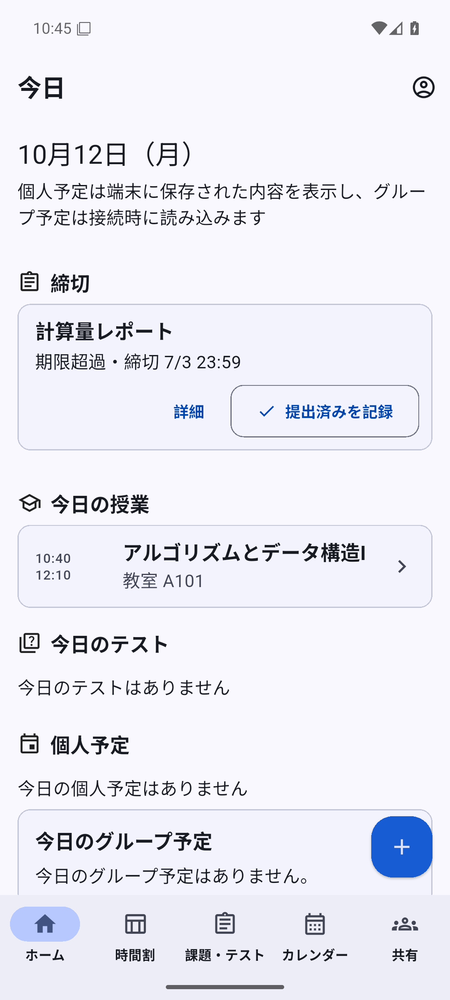
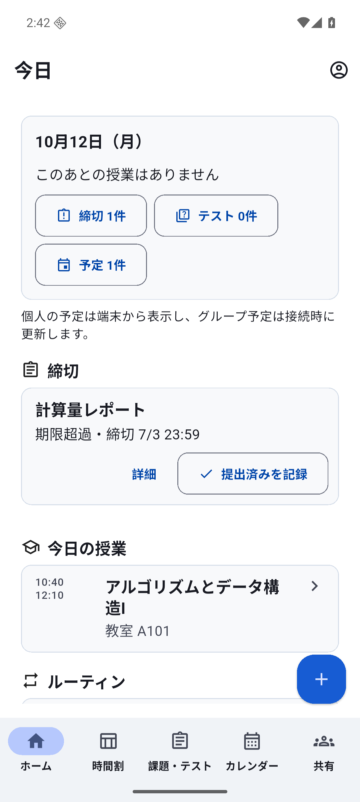
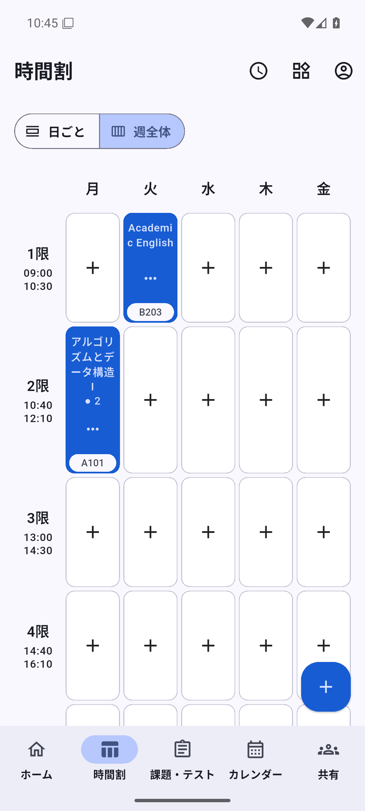
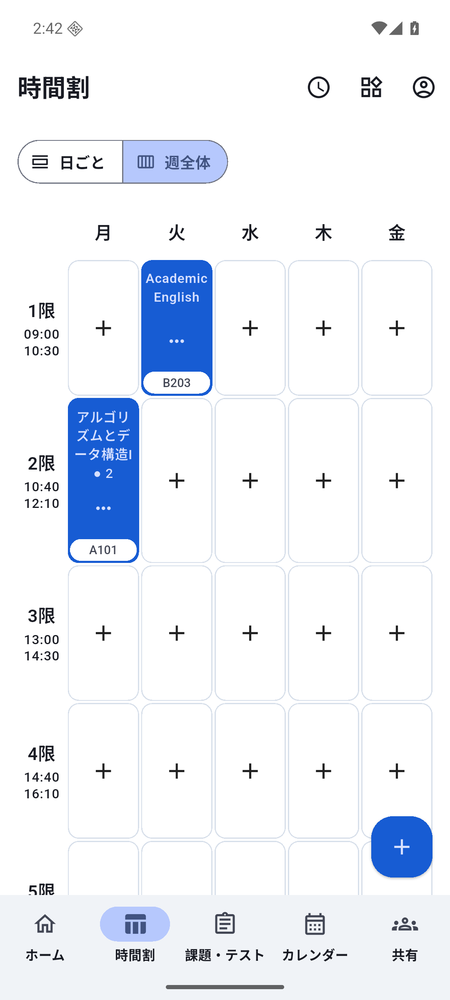
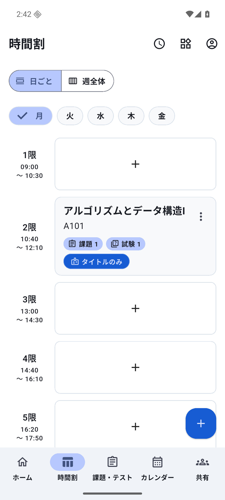
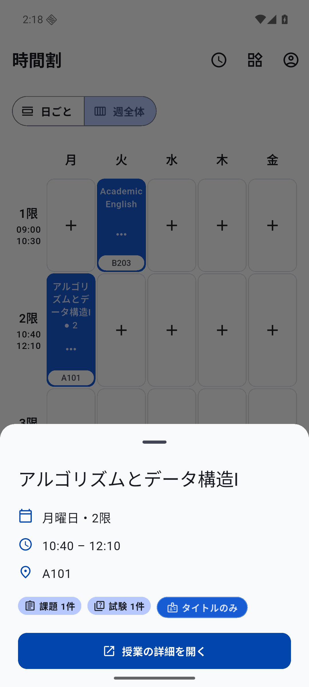
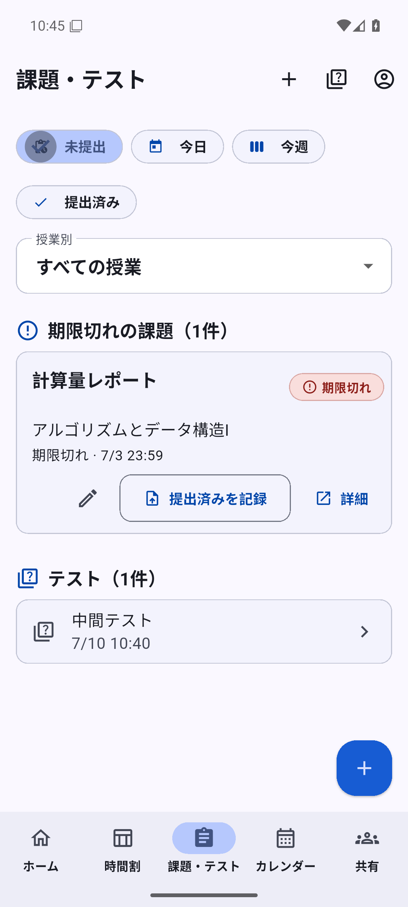
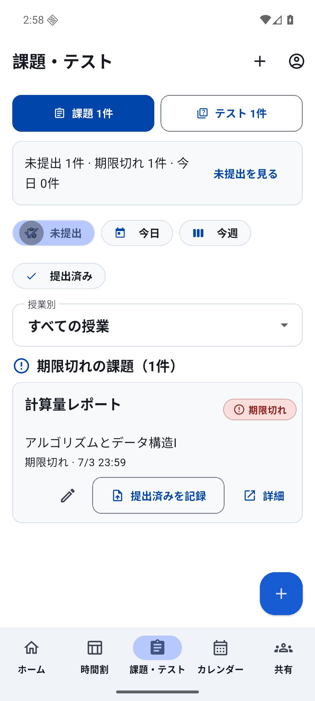
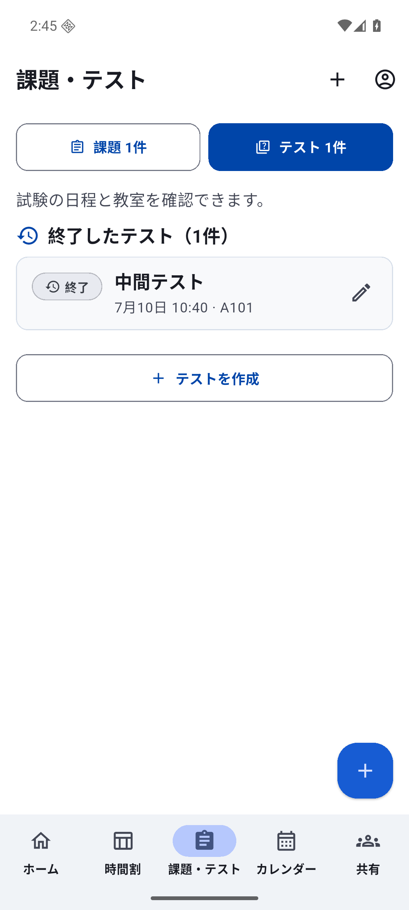

# Academic UIの比較と受入範囲

v1.0とv1.1の同じ架空デモデータを、専用Android API36 AVDで撮影した比較です。実ユーザーの操作時間や満足度の調査ではありません。改善の根拠は[公式資料の比較](UX_RESEARCH_V1_1.md)と既存画面・ソースの観察です。[編集可能な設計](UX_DESIGN_SYSTEM.md)と[検証結果](TESTING.md)を併読してください。

## Today

上部に日付・現在または次の授業と教室・締切・試験・予定への入口をまとめました。予定がある節は残し、空の節を減らしています。授業が終了した撮影時点では、その状態を正直に表示します。期限超過、更新中、失敗時の再操作、提出後のUndoは従来の保存処理に接続しています。

 

## 時間割

日表示を入口にし、週全体の俯瞰も維持します。週の長い科目名は省略されるため、タップで全文・曜日・時限・実際の時刻・教室・関連課題と試験を表示します。管理操作と選択を分け、空のコマは中立の追加領域です。週の行見出しに時刻を表示するのは、5曜日の設定が一致する場合だけです。未設定と曜日別の違いを混同しません。

 

 

## 課題とテスト

同じ位置の明示的なモード切替で、課題と試験を往復できます。件数は全状態・全日程のローカルスナップショットを指し、読み上げでも説明します。未提出・期限超過・今日の件数から確認へ進め、既存の期間・授業フィルタ、提出記録とUndoを維持します。状態は文字とアイコンでも識別できます。

 

## 再現する導線

1. READMEのlocal/demoビルドを起動し、架空メールでfake Authに入る。
2. Homeの「今日の予定を見る」からTodayへ進み、概要と締切を確認する。
3. 下部ナビの時間割で日・週を切り替え、授業をタップして全文と教室を確認する。
4. 明示的に授業詳細を開き、関連課題と試験へ進む。
5. 課題で提出済みを記録し、直後の「元に戻す」で状態を復元する。課題とテストを往復する。

幅・文字拡大・明暗・キーボード・安全領域・reduced motionのwidget確認と、AVDでの操作は層を分けて記録しています。実際のTalkBack利用体験、物理端末性能、iOS、ホスト型Authや通知、実ユーザーの比較優位は未受入です。画像だけからこれらの合格を推測しません。任意の空間表現はこの2D導線とは独立して評価します。
