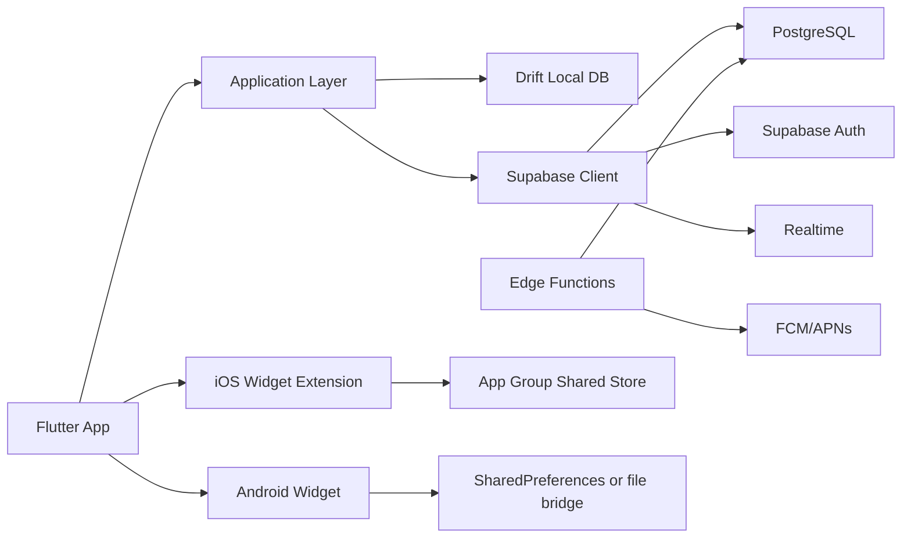
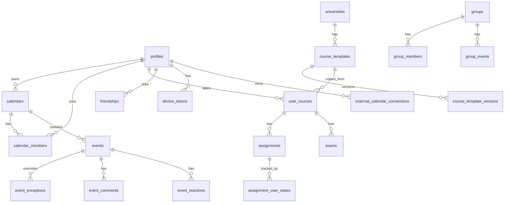

# 大学生向け共有スケジュールアプリの開発実装リサーチ

参照日: 2026-06-28

## まず結論

このアプリは、**Flutter をモバイル本体に使い、ローカル永続化は Drift + SQLite、バックエンドは Supabase + PostgreSQL、認証は Supabase Auth、リアルタイム反映は Supabase Realtime、通知は FCM + APNs、ウィジェットは iOS を WidgetKit、Android を Jetpack Glance のネイティブ実装**という構成が、現時点で最も現実的です。理由は、Flutter 自体に公式のアーキテクチャ指針があり、iOS の app extension 連携も公式ガイドが整っていること、Supabase が Postgres の RLS を前提にした堅い権限制御を提供していること、そして大学生向けの時間割・課題・グループ予定という**関係が多いドメイン**が relational model と非常に相性が良いからです。 citeturn16view0turn17view0turn15view1turn43view0turn43view1

実装上の最重要論点は五つです。第一に、**公開範囲の実装を単純な「events テーブル直読」にしないこと**です。`PRIVATE / BUSY_ONLY / TITLE_ONLY / FULL` を予定単位・友だち単位・グループ単位で重ねると、RLS だけで列マスキングまで安全に完結させるのは難しく、**非公開イベントの原本と、相手に見せる投影データを分ける設計**が必要です。第二に、**繰り返し予定を「元ルール + 例外」で持つこと**です。RFC 5545 でも再帰集合は `DTSTART + RRULE/RDATE - EXDATE` で定義され、単一インスタンス変更には `RECURRENCE-ID` が使われます。第三に、**授業テンプレは共有元を直接参照せず、個人側へスナップショットコピーすること**です。第四に、**ウィジェットは Flutter 単体ではなくネイティブ extension / widget 側と共有ストレージで橋渡しすること**です。第五に、**オフライン同期は Realtime 依存ではなく、ローカル DB とサーバー差分同期を主軸にすること**です。 citeturn15view1turn15view2turn38view0turn38view1turn38view2turn17view0turn17view4

MVP で最初に検証すべき PoC は、機能数よりも設計リスクが高い順に、**公開範囲付き予定参照、繰り返し予定の例外処理、授業テンプレ重複判定、ウィジェットへの共有データ反映、オフライン outbox 付き同期**です。これが成立すれば、その後の課題・テスト・グループイベント・コメントは比較的素直に積み上がります。 citeturn15view0turn15view3turn38view1turn43view0turn17view0

## 技術スタックの最終判断

### モバイル本体

Flutter は、保守性とスケールのための公式アーキテクチャガイドを持ち、UI layer・data layer・dependency injection・testing を分ける形を推奨しています。特に今回のような「画面数が多い」「オフライン」「共有」「通知」「ネイティブ拡張あり」というアプリでは、単純な画面直書きより、**機能単位で層を分けた構成**にしておくほうが後から確実に効きます。 citeturn16view0turn16view1

したがって推奨は、**Flutter + Feature First + Clean-ish layering** です。具体的には `features/` 配下に `auth`, `timetable`, `calendar`, `groups`, `assignments`, `widgets_bridge`, `settings` を切り、各 feature ごとに `presentation / application / domain / data` を持たせます。`presentation` は画面、`application` は use case と state、`domain` は entity と policy、`data` は Supabase client・Drift DAO・mapper を担当します。これは Flutter 公式の層分離の方向性と一致しています。 citeturn16view0turn16view1

### 状態管理

状態管理は **Riverpod を第一推奨**にします。Riverpod は自らを「reactive caching and data-binding framework」と定義し、非同期処理、エラー、ローディング、UI からのロジック分離、テストしやすさを前面に出しています。一方、Provider は `InheritedWidget` を扱いやすくするラッパーで、より軽量ですが、今回のような非同期キャッシュ、依存注入、画面横断状態、テスト容易性を強く求めるケースでは Riverpod のほうが素直です。BLoC は強い設計規律を提供しますが、そのぶんイベント・状態の記述量が増えやすく、個人または少人数の初期実装ではやや儀式的になりやすいです。 citeturn42view0turn42view1turn42view2turn42view3

結論として、**Riverpod + AsyncValue + code generation** が最もバランスが良いです。BLoC は「複雑な状態遷移を厳密にイベント駆動で追いたい画面」に限定して部分採用する余地がありますが、全体統一は Riverpod のほうが実装速度と保守性の均衡が良いです。これは package の説明からの推論ですが、今回の要件ではかなり妥当です。 citeturn42view1turn42view3

### ローカル DB

ローカル DB は **Drift を第一推奨**にします。Drift は relational data を対象にした reactive persistence library で、型安全、SQL と Dart の両方での記述、stream query、マイグレーション、isolate 対応を備えています。今回のアプリでは、`User`, `Calendar`, `Event`, `Assignment`, `Group`, `Attendance`, `Course`, `VisibilityRule` のように**結合・絞り込み・並び替え・集計が頻繁**に発生するため、SQLite 上で relational に持てる利点が大きいです。特に「今週の時間割」「複数カレンダー統合表示」「締切だけ抽出」「見せてよい予定だけ投影」といった要求は、key-value より SQL のほうが圧倒的に楽です。 citeturn43view0turn43view1

Isar は Flutter 向けの高速なクロスプラットフォーム DB で、ACID・全文検索・マルチアイソレート対応を打ち出していますが、基本は NoSQL/オブジェクト寄りです。ローカル単体アプリなら非常に魅力的ですが、**サーバー側が PostgreSQL である以上、クライアント側も relational に寄せたほうが mapping と同期設計が簡単**です。Hive は「pure Dart の key-value DB」で、クエリ・関係・複雑な join を前提にしていません。Realm は現在もローカル DB としては使えますが、公式リポジトリで Atlas Device Sync + Realm SDKs の deprecation が案内されており、少なくとも「同期も含めて Realm を主軸にする」判断は避けたほうがよいです。ObjectBox は高速・offline-first・sync を強く打ち出していますが、今回の設計は PostgreSQL を中核に据えるため、最初から二重のデータモデル思想を持ち込まないほうが安全です。 citeturn43view2turn43view3turn44view0turn43view4

### バックエンド

バックエンドは **Supabase + PostgreSQL** が適切です。Supabase は exposed schema 上のテーブルで RLS を有効にすることを強く求めており、RLS がなければ publishable key 経由で API からデータにアクセスできなくなります。さらに、RLS と Auth を組み合わせたブラウザ/モバイルからの end-to-end security を正面からサポートしています。あなたのアプリは「友だちには空きコマだけ」「グループにはタイトルだけ」「本人だけ詳細」といった**とても細かい閲覧制御**が中心なので、NoSQL ルールよりも Postgres の RLS と SQL のほうが自然です。 citeturn15view1

Supabase Realtime も使えますが、公式ドキュメントは **Broadcast を“most use cases”向け、Postgres Changes を quick testing / low amount of connected users 向け**と整理しています。したがって、初期の実装は簡単な Postgres Changes で始めてもよいですが、長期的には「イベントコメント通知」「グループ参加回答」「ウィジェット反映トリガー」などは Broadcast やサーバー発行イベントに寄せるほうが良いです。Presence は online/offline 表示のような用途向けで、計算コストがあるため最小限にすべきとされています。 citeturn41view0turn41view1turn41view2

## 推奨アーキテクチャと Flutter 実装方針

### 推奨構成

この構成では、**Drift がオフライン参照の一次ソース、PostgreSQL が正本、Realtime は更新加速器**です。つまり、アプリはまず Drift から描画し、ネット接続があれば差分同期し、Realtime は「今変わった」ことを早く知るために使います。Realtime を唯一の同期手段にすると、バックグラウンド停止・切断・再接続・ページングで不整合が出やすいので、**差分取得 API / RPC を主軸**にするのが安全です。これは Google Calendar の `syncToken` や Microsoft Graph の `deltaLink` が、どちらも「完全同期 + 増分同期」の二段構えを前提にしていることとも整合します。 citeturn39view0turn40view0turn40view1turn41view0

### Flutter 側の実装ルール

Flutter 側では、画面 state を大きく三層に分けると安定します。**UI state**, **domain state**, **sync state** です。UI state は選択中タブやスクロール位置。domain state は「今週の統合予定」「時間割の表示セル」「課題一覧のフィルタ済み結果」。sync state は「同期中」「未送信操作あり」「競合あり」です。これを一つの巨大 state object にせず、Riverpod provider を feature 単位で細かく分けるほうが追跡しやすいです。Riverpod 自体が非同期の loading/error handling と UI 分離を前提にしています。 citeturn42view1

ルーティングは `go_router`、DTO/Union/immutable model は `freezed`、JSON 変換は `json_serializable` が無難です。これら自体は package 推奨ですが、Flutter の公式アーキテクチャが「依存注入・層分離・テスト可能性」を重視しているので、それに合わせた選択として合理的です。 citeturn16view0turn16view1turn10view0turn10view1turn10view2

### オフライン同期

最初から必要なのは「完全双方向の汎用 CRDT」ではなく、**用途別の競合戦略**です。個人予定はほぼ Last Write Wins で足りますが、グループイベントは `version` を持たせて optimistic concurrency にし、編集中に誰かが変えたら差分確認 UI を出すべきです。課題提出状態は `AssignmentUserState` を別テーブルに分けて、課題本体（締切・説明）と個人状態（未着手・提出済み）を分離してください。これで「グループ共有情報」と「自分の提出進捗」が衝突しません。RFC 5545 由来の recurrence についても、**元イベントを直接書き換えず、例外だけを積む**方針が同期衝突に強いです。 citeturn38view1turn38view2

実装としては、ローカルに `pending_mutations` を持ち、各変更に `client_mutation_id`, `entity_type`, `entity_id`, `operation`, `payload`, `created_at` を保存して outbox 処理します。サーバー成功時に消し込み、Query 系は Drift 再計算で UI を更新します。これ自体は推奨設計ですが、Google と Microsoft がどちらも opaque token を用いた増分同期を採用している点から見ても、**“変更を積んで追いかける” 発想**が正道です。 citeturn39view0turn40view1

## PostgreSQL スキーマと RLS 設計

### 設計の基本方針

このアプリでは、**原本テーブルと表示テーブルの責務を分ける**のが重要です。`events` に秘密情報を全部持ちつつ、`BUSY_ONLY` の相手にも同じ行を返してアプリで隠す、という設計は避けてください。RLS は行の可否には強いですが、「同じ行のこの列だけ隠す」を複雑な関係グラフでやると漏えいリスクが高くなります。しかも Supabase の view は、Postgres 15 以降で `security_invoker = true` を使わないと、基底テーブルの RLS をそのまま守らない場合があります。 citeturn15view2

したがって、DB 設計は次の五層が安全です。`private source tables`、`membership tables`、`visibility rule tables`、`redacted projection functions/views`、`write RPC / Edge Functions` です。管理者処理には service role key を使いますが、Supabase は service key をブラウザで使うべきではないと明示しています。複雑なポリシー判定は security definer function に逃がせますが、Supabase はそれを exposed schemas に置くなと注意しています。 citeturn15view3turn15view0

### 推奨主要テーブル

MVP で最低限必要なのは、`profiles`, `universities`, `university_email_verifications`, `friendships`, `groups`, `group_members`, `calendars`, `calendar_members`, `events`, `event_exceptions`, `event_attendees`, `event_comments`, `event_reactions`, `course_templates`, `course_template_versions`, `course_template_suggestions`, `user_courses`, `assignments`, `assignment_user_states`, `exams`, `notification_settings`, `device_tokens`, `external_calendar_connections`, `audit_logs` です。時間割は `user_courses` と `events` の二重管理にせず、**授業は timetable-aware な event として見せつつ、course 固有情報は `user_courses` に持つ**のが扱いやすいです。たとえば「月曜 2 限の授業自体」は `user_courses`、その週の補講や休講により実際に表示される出現は `events / event_exceptions` で表現します。 citeturn38view1turn38view2

### 公開範囲の DB モデル

推奨は、イベント原本に `visibility_base` を置きつつ、相手関係ごとの override を別テーブル化する形です。

- `events.visibility_base`
  既定値。`PRIVATE / BUSY_ONLY / TITLE_ONLY / FULL`
- `event_visibility_overrides`
  `event_id, subject_type(friend|group|calendar_member_role), subject_id, level`
- `calendar_shares`
  カレンダー単位の既定共有
- `friendships`
  承認済み友だち関係
- `group_members`
  グループ membership と role

実ユーザーへの表示は、`rpc_get_visible_events(viewer_id, range_start, range_end)` のような **security definer 関数**で「その viewer に見せてよい形」に整形して返すのが最も安全です。RLS の生 SELECT で全部解決しようとすると、`BUSY_ONLY` の判定・空きコマ計算・コメント可否・グループ管理者可視範囲などが急速に複雑になります。Supabase の RLS docs も、複雑な join 判定では security definer function や join の書き換えが性能上有利だと示しています。 citeturn15view0turn15view1

### RLS ポリシー方針

RLS は最低でも以下の原則が必要です。

- `profiles`: 本人更新のみ。公開プロフィールは別 view / 関数。
- `friendships`: 当事者二人のみ参照。作成者だけではなく双方の承認状態を見る。
- `groups`: group member のみ参照。Owner/Admin のみ更新可。
- `events`: 原本は owner / calendar manager / event author のみ直読可能。
- `event_comments`: event が見える人だけ read。書き込みは member 以上。
- `course_templates`: 同大学のみ read。proposal/create は認証ユーザー。
- `course_template_suggestions`: 提案者と管理フローのみ参照。
- `assignment_user_states`: 本人のみ read/write。
- `device_tokens`: 本人のみ read/write。
- `audit_logs`: client 直アクセス禁止。

ビューを使う場合は `security_invoker = true` を原則とし、service key は Edge Functions / admin のみで保持してください。Supabase は service keys を browser に置くなと明示しています。 citeturn15view2turn15view3

### 授業テンプレ重複判定

授業テンプレは **同一大学内共有のみ**で正しいです。DB では `course_templates.university_id` を必須にし、検索もそこに限定してください。重複判定は以下の二段階が堅いです。

まず exact 用に、アプリまたは Edge Function 側で NFKC・大文字小文字統一・空白圧縮・敬称除去を行って、`normalized_title`, `normalized_instructor`, `normalized_room` を保存します。そのうえで exact 候補は `university_id + normalized_title + normalized_instructor + weekday + period + term_code` でハッシュキー化します。次に near-duplicate 候補を `pg_trgm` と `levenshtein` で探します。PostgreSQL の `pg_trgm` は trigram similarity と GIN/GiST index による高速類似検索を提供し、`LIKE/ILIKE` や similarity operator を高速化できます。`fuzzystrmatch` は `levenshtein` を提供します。`citext` は case-insensitive 比較に使えますが、今回の日本語正規化要件では、**正規化済み text カラムを明示的に持つ**ほうが管理しやすいです。 citeturn33view0turn34view0turn34view2

重要なのは、**コピー後は `user_courses` にスナップショット保存**することです。Google Calendar の recurring event でも、単一インスタンス変更は系列本体とは別に exception を持ちます。同様に、テンプレ原本を直接個人時間割に bind すると、後からテンプレ変更が全員に波及して壊れます。個人時間割は独立した owned data にしてください。 citeturn39view4turn38view2

## 繰り返し予定・外部連携・通知

### 繰り返し予定の内部表現

繰り返し予定は RFC 5545 に寄せて、**ルール保存 + 例外保存**にしてください。RFC 5545 では recurrence set を `DTSTART` と `RRULE/RDATE/EXDATE` から生成し、`EXDATE` が優先、重複は無視されます。また、単一インスタンスの特定には `RECURRENCE-ID` が使われます。Google Calendar も単一インスタンス変更を「exception」として扱い、以後全部変更するときは元シリーズを `UNTIL` で切って新シリーズを作る手順を案内しています。つまり、**「毎回展開して全部保存」より、「元ルール + 必要な範囲だけ投影」**が正しいです。 citeturn38view0turn38view1turn38view2turn39view3turn39view4

実装推奨は次の形です。

- `events`
  単発と recurring master を共通化
- `recurrence_rule_text`
  例: `FREQ=WEEKLY;INTERVAL=2;BYDAY=MO,WE`
- `timezone`
- `event_exceptions`
  `event_id`, `recurrence_id`, `mode(cancelled|modified)`, override fields
- `event_occurrence_cache`
  直近 90 日や widget 表示範囲だけ非正規化キャッシュ

こうしておくと、時間割ウィジェットや月間表示はキャッシュから高速に出しつつ、正本は rule + exceptions のまま保てます。 citeturn38view1turn38view2

### 外部カレンダー連携

Google Calendar 連携は、MVPでは **読み取りインポート優先**が良いです。Google Calendar API は recurring events、free/busy、sync token、push watch をすべて公式に提供しています。`syncToken` による増分同期と、`freeBusy` による空き時間取得が使えるため、大学生の「友だちとの空き時間比較」や「既存個人カレンダーの取り込み」と相性は良いです。一方で、最初から双方向同期にすると、権限、競合、重複、削除伝播の設計が一気に難しくなります。MVP は **read-only import + 明示的再同期**、その後に write-back を検討するのが現実的です。 citeturn39view0turn39view2turn39view5turn39view6

Microsoft Graph も delta query と change notifications を提供しており、Outlook 連携自体は可能です。ただし Graph の delta は calendar view ごとに start/end を持って追跡し、token を保持する必要があります。Group events には Outlook reminder の差分など挙動差もあります。MVP で Google 優先、Graph は後追いで十分です。 citeturn40view0turn40view1turn40view2turn40view4

ICS / iCalendar は、**大学ポータルやシフトサービスが API を出していない場合の現実解**として重要です。内部 recurring model も RFC 5545 に寄せておけば、ICS import/export の実装負債を減らせます。 citeturn38view0turn38view1

Apple Calendar のローカル統合は将来候補ですが、MVP の中心に置くべきではありません。まずは自前 DB と Google 連携を固めるほうが効果対コストが高いです。 citeturn17view0

### 通知設計

通知は **ローカル通知 + プッシュ通知のハイブリッド**が基本です。課題締切、授業開始前、バイト前のような個人予定はローカル通知。グループ招待、コメント、参加回答変更、テンプレ更新提案承認などサーバー発の事象は push に向いています。FCM の Flutter ガイドでは、Apple 側で push notification capability と background modes が必要であり、APNs authentication key のアップロードが必要です。また、Apple デバイスでは method swizzling や APNs token availability に注意が必要です。 citeturn25view0turn25view1turn25view4

Android 13 以降では `POST_NOTIFICATIONS` が runtime permission になり、新規インストール時は通知が既定で off です。したがって、初回起動でいきなり要求せず、「課題締切通知を有効にする」など文脈付きで許可を求めるべきです。これは Android 公式も推奨しています。 citeturn24view0turn24view1

Exact alarm は慎重に扱ってください。Android 14 では `SCHEDULE_EXACT_ALARM` が多くの新規アプリで既定 deny になり、設定画面への誘導が必要です。カレンダー/アラーム時計アプリは `USE_EXACT_ALARM` を宣言できる余地がありますが、Play 側の解釈と審査を考えると、MVP では **exact alarm を前提にしない通知設計**が安全です。標準的な締切通知は local notification + background refresh で十分です。 citeturn24view2turn24view3turn24view4

## ウィジェット実装とストア公開までの実務論点

### 今週の時間割ウィジェット

Android では Jetpack Glance が、Compose runtime 上で app widget を Kotlin API で作れると公式に説明しています。Widgets は glanceable information を出すためのもので、ホーム画面上の制約から gesture は限られ、リサイズ戦略が重要です。また、`updatePeriodMillis` による更新要求は **30 分より短く配信されない**ことが API reference に明記されています。したがって、今週の時間割ウィジェットは「授業が変わるたび即時反映」を前提にせず、**アプリ更新時の手動 push と一定間隔再描画**で設計すべきです。 citeturn18view0turn19view2turn23view0turn23view2

iOS では WidgetKit は app extension として実装し、Flutter 公式ガイドも iOS app extensions の追加手順、App Group による共有、deep linking、background updates、limited memory を説明しています。Flutter extension 側から shared resources を読み書きでき、`home_widget` package を使うと `UserDefaults` 保存や Dart コードとの橋渡しがしやすくなります。したがって、MVP では **Flutter アプリで「今週の表示モデル」を生成 → App Group に保存 → WidgetKit が読む**構成が妥当です。 extension 内で複雑な業務ロジックを再実装しないでください。 citeturn17view0turn17view4

ウィジェットから該当画面へ飛ぶ導線は、iOS は universal links、Android は app links で固めるのがよいです。Flutter 公式 cookbook では、iOS は Associated Domains + `apple-app-site-association`、Android は `assetlinks.json` を `.well-known` に配置する構成が案内されています。これを最初に整えておくと、通知タップ・ウィジェットタップ・共有招待リンクをすべて同じ deep link 基盤に乗せられます。 citeturn45view0turn45view1turn45view3turn45view4

### ストア審査と UGC 対応

このアプリは、イベントコメント・リアクション・テンプレ共有という意味で **UGC を含みます**。Apple は UGC を含むアプリに、 objectionable material filter、報告機能、abusive user の block、連絡先公開を求めています。Google Play も、UGC を含むアプリには in-app の report と block を要求しています。したがって、コメントとテンプレ共有を MVP に入れるなら、**通報・ブロック・簡易モデレーション導線**は MVP に入れるべきです。これは nice-to-have ではなく審査要件に近いです。 citeturn27view0turn27view4turn27view5

アカウント削除も必須です。Apple は、アカウント作成をサポートするアプリは app 内から削除開始できる必要があると案内しています。Google Play も、アカウント作成がある場合は in-app path と web link の両方を求めています。したがって、設定画面に **「アカウント削除」** を明示配置し、7 日猶予や再認証などは入れてよいが、面倒すぎるフローにはしないことが重要です。 citeturn27view1turn27view2turn27view3

### 日本向け個人情報・セキュリティ

日本では個人情報保護委員会が APPI の公式文書を公開しており、英訳は参照用で法的効力は日本語原文のみです。APPI では、利用目的の特定、目的外利用の制限、安全管理措置、漏えい等報告、第三者提供制限、開示・訂正・利用停止等への対応が法律上の柱になっています。特にこのアプリでは、大学名、授業、教室、バイト予定、友人関係が組み合わさると**行動パターンや生活圏の推定が可能**になるので、これらは通常のメモアプリよりも慎重に扱うべきです。初期公開範囲を `PRIVATE` にする方針は妥当です。 citeturn29view0turn31view0turn31view1turn32view0

## 実装優先順位と PoC

### 最初の三か月でやるべきこと

最初に作るべきは、**個人価値が高く、共有の核にもなる基本面**です。具体的には、認証、大学選択、時間割登録、ウィーク表示、個人予定、課題、テスト、公開範囲 `PRIVATE/BUSY_ONLY/TITLE_ONLY/FULL`、友だち追加、グループ作成、グループイベント、参加回答、イベントコメント、イベントリアクション、今週の時間割ウィジェットです。ここで重要なのは、グループチャットやファイル添付ではなく、**「予定が正しく見えて、見せすぎない」こと**です。 citeturn15view1turn17view0turn18view0

PoC は次の順で進めるのが現実的です。

まず、**可視性 PoC**。同じイベントを本人、友だち、グループメンバー、非メンバーでどう見せ分けるかを DB/RLS/関数レベルで確定させます。
次に、**繰り返し予定 PoC**。隔週、毎月第 N 曜日、1 回だけ変更、1 回だけ削除を実際に生成してキャッシュ表示まで通します。
次に、**授業テンプレ PoC**。正規化済み列、大学内絞り込み、類似候補、重複検知、コピー後スナップショット化を通します。
その次に、**Widget bridge PoC**。Flutter → shared store → WidgetKit/Glance → deep link 遷移を通します。
最後に、**offline sync PoC**。機内モードで作成・編集・削除し、復帰後に outbox 同期して競合を処理します。 citeturn38view1turn33view0turn34view2turn17view0turn23view0

### 六か月までの拡張

六か月までには、Google Calendar の read-only import、課題と締切の改善、テンプレ修正提案フロー、大学メール認証バッジ、管理画面、ログ監査を入れる価値があります。Google Calendar は incremental sync と free/busy の公式サポートがあるため、最初の外部連携としては最適です。逆に、Graph、ICS 双方向同期、LMS 連携、シフト自動読取、画像 OCR は後段に回すべきです。 citeturn39view0turn39view2turn39view5

### 推奨開発環境と運用

開発基盤は **Supabase CLI + Docker のローカル開発**を必須にしてください。Supabase 公式も、CLI によりローカル Postgres/Auth/Storage 等を立ち上げ、マイグレーションや secrets 管理、デプロイを行えるとしています。RLS の検証は本番に近いローカルスタックでやらないと事故りやすいです。 citeturn15view5turn15view6

CI/CD は、推奨として **GitHub Actions を中心にした mono-repo パイプライン**が扱いやすいです。流れは、`flutter analyze`、unit/widget test、Drift codegen、SQL migration lint、Supabase migration dry-run、Android/iOS build、internal distribution、store submit の順です。ここは推奨設計ですが、少人数開発では Flutter 側と DB migration を一つの pull request で同期させやすい方式が重要です。

admin は **Next.js を第一推奨**にします。理由は、テンプレ審査、通報処理、大学追加申請、簡易分析といった Backoffice はテーブル CRUD が中心で、Flutter Web より web admin のほうが実装速度が出やすいからです。これは実装上の推奨です。

## オープンクエスチョンと限界

Apple の WidgetKit / EventKit については、公式ページ自体は確認できましたが、Web 取得の都合で一部の細かな仕様文面までは十分に引けていません。特に **EventKit の最新 permission distinction の実装細部**は、実装前に Xcode 実機で一度 PoC するのが安全です。 citeturn6view0turn6view2turn6view3

Realm はローカル DB として今も利用可能ですが、Atlas Device Sync / Realm SDKs の deprecation 影響範囲が選択肢評価に大きく関わるため、少なくとも**同期基盤として採用しない**という判断までは固い一方、完全なローカル限定採用の是非は追加検証余地があります。 citeturn44view0

最後に、大学独自システムやシフト管理サービスの連携は、今回の調査範囲内では「どう作るか」の中心ではないため深追いしていません。MVP の実装判断としては、**外部 API 連携は後回しで正しい**です。まず自前の時間割・予定・共有・権限・繰り返し・ウィジェットを完成させ、その後に Google Calendar から始めるのが最も現実的です。 citeturn39view0turn39view2turn17view0
