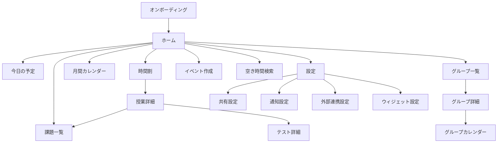
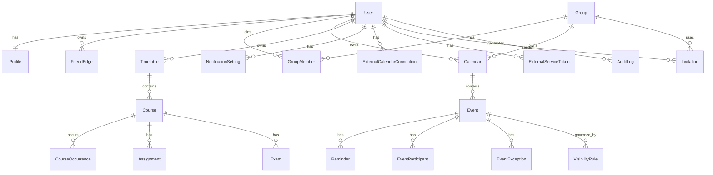
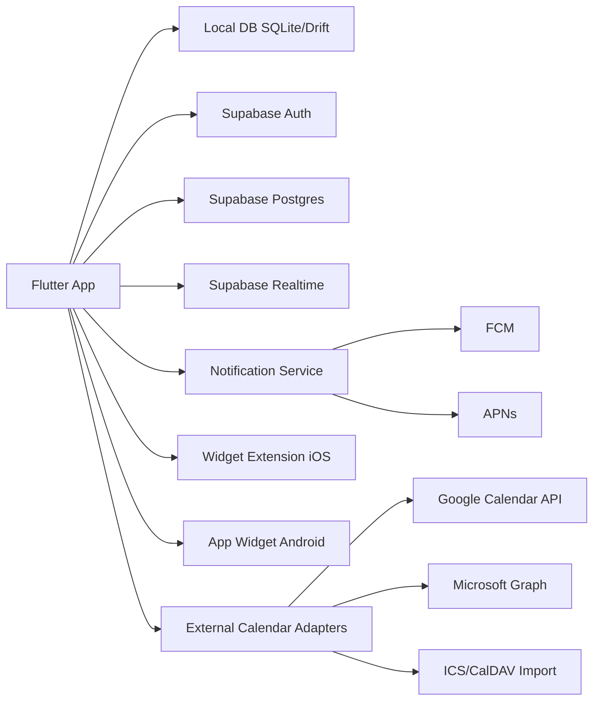

# 大学生向けスケジュール管理アプリ調査レポート

参照日: 2026-06-28 JST

## エグゼクティブサマリー

作るべきものは、**大学生活に特化した「時間割中心の個人管理」**と、**TimeTree型の「限定共有カレンダー」**を一体化したモバイルアプリです。既存の強いプレイヤーを見ると、すごい時間割は授業データ・出欠・課題・テスト・友だち共有に強く、TimeTreeはグループ単位の共有カレンダーに強い一方、**大学の授業・課題・テスト・空きコマ・グループ予定・ルーティン予定・限定公開のプライバシー制御**を同時に深く扱う製品は見当たりません。差別化の核は、**授業起点の予定管理**と**「見せすぎない共有」**を両立することです。 citeturn27view2turn28view1turn28view2turn28view0

MVPで最優先にすべきなのは、**時間割、課題、テスト、通常予定、ルーティン、友だち共有、グループ共有、公開範囲制御、通知、シンプルなウィジェット**です。これだけで「授業を落としにくくする」「空きコマを合わせやすくする」「サークルやゼミの予定調整が楽になる」という大学生の中核課題をかなり広く解けます。逆に、LMS自動連携、シフト自動取得、OCR、双方向カレンダー同期、複雑な候補日投票、全文検索の高度化は、MVPでは後回しが妥当です。Google Calendar / Microsoft Graph は強力ですが、OAuth、トークン管理、同期競合、Webhook、審査対応の負荷が上がります。 citeturn29search15turn29search3turn29search0turn20search2turn19search0turn19search1

技術スタックは、**Flutter + Supabase + PostgreSQL + ローカルSQLite系**を第一推奨にします。理由は、授業・課題・試験・共有・公開範囲・繰り返し予定・例外日・監査ログといったこのアプリの中心は**リレーショナルで権限が細かいデータ**であり、Supabase の Postgres + RLS が非常に噛み合うからです。一方で Flutter は iOS/Android 両対応の開発速度が高く、ただしウィジェットは Flutter だけでは完結せず、**iOS/Android のネイティブ実装が必要**です。そこは最初から前提にした設計が必要です。 citeturn17search0turn17search6turn35search0turn35search2turn10search0turn10search2turn10search1

ウィジェットは**MVPに入れる価値が高い**です。ただし、**最初から二種類フル実装ではなく、一種類だけ**に絞るべきです。添付イメージに近い「今週の時間割」または「今日と次の予定」ウィジェットは、毎日ホーム画面で価値が出るため、継続利用のフックになります。月間カレンダー型は後続でよく、WidgetKit と Android App Widgets/Glance の更新制約を踏まえると、最初は**閲覧中心・タップ遷移中心**が堅実です。 citeturn26search15turn26search0turn8search17turn26search5turn26search2

## 競合とユーザー課題

主要競合を要約すると、下表の通りです。ここでは、大学生向けの文脈に本当に効く観点だけに絞っています。

| サービス | 主な機能 | 強み | 弱み | 取り入れるべき点 | 参考 |
|---|---|---|---|---|---|
| すごい時間割 | シラバス/授業データ、出欠、課題、テスト、友だち共有、ウィジェット | 大学生向け特化、授業データ流用で登録が速い | 共有カレンダー・グループ運用はTimeTreeほど前面に出ていない | 授業データの再利用、授業起点の課題/テスト管理、次コマ系ウィジェット | citeturn27view2turn24search3 |
| TimeTree | グループ共有カレンダー、招待、複数共有カレンダー、フィルタ | グループ予定共有がわかりやすい | 大学の時間割や課題・試験には特化していない | グループ単位の共有、招待導線、複数カレンダー切替 | citeturn28view1turn11search6 |
| Google Calendar | 共有カレンダー、通知、API、FreeBusy | 連携先として最重要、APIが強い | 大学特化のUI/課題導線は弱い | 外部連携先として採用、読み取り専用から開始 | citeturn12search0turn12search4turn31search3 |
| Apple Calendar | iCloud共有、CalDAV、EventKit | OS統合、ローカル保存との親和性 | 開発側は権限設計とiOS制約に注意 | ローカル書き込み・読取権限を慎重に使う | citeturn12search5turn12search9turn5search6 |
| Outlook Calendar | 共有カレンダー、Group calendar、Graph API | 研究室・大学職員系で有力 | 実装はOAuth/Graphの知識が要る | 将来の大学・研究室用途に備えた後続連携先 | citeturn12search2turn12search14turn29search0 |
| Notion Calendar | 複数カレンダー接続、タイムゾーン、スケジューリング、ウィジェット | デザイン、複数カレンダー統合、予定可視化 | 授業・出欠・空きコマ共有には弱い | 複数カレンダー俯瞰、洗練UI、busy auto-blockの発想 | citeturn28view2 |
| MyStudyLife | 授業・課題・試験・ローテーション時間割・ウィジェット | 学生向け導線、課題/試験一体化 | 日本の大学共有・友人グループ文脈は弱い | 学生向け語彙、課題/試験一体ビュー、学習負荷の見せ方 | citeturn27view5turn28view0 |

この市場で本当に埋まっていない穴は、**「授業と私生活を一つのモデルで扱いながら、共有は可視性を細かく刻む」**ことです。大学生は「全部見せたい」のではなく、**授業名までは見せたくないが空きコマは見せたい**、**バイト先は見せたくないがその時間が埋まっていることだけ見せたい**、**ゼミの予定だけは研究室メンバーに詳細共有したい**という使い方をします。TimeTree の共有思想と、すごい時間割の授業中心思想を、そのまま足し算するだけでは足りず、**可視性モデルを最初から一級オブジェクトとして設計する必要**があります。 citeturn27view2turn28view1turn11search13

想定ペルソナは、学部生・院生・サークル所属・バイトあり・授業数が多い学生です。主要ユースケースは、**履修登録直後に時間割を作る、毎週課題と小テストをさばく、友人と昼休みや放課後の空き時間を合わせる、サークル/ゼミでイベントを組む、バイトやジムのルーティンを重ねて全体最適を見る**、の五つです。Google と Microsoft は FreeBusy/meeting-time 系APIを持っており、将来的には外部カレンダーの「予定名を見せず空き時間だけ使う」設計にも寄せやすいです。 citeturn31search3turn31search1turn31search15

ユーザーストーリーとしては、たとえば「同じ授業を取る友人が休講情報やレポート締切を補完できる」「3限後に空いている友人だけ検索したい」「バイトの固定シフトと大学の試験を同じ週表示で重ねたい」「グループイベントは出すが私的予定の詳細は隠したい」が中核です。これは既存競合の一部機能の寄せ集めではなく、**大学生活の関係性とプライバシー制御を前提にした新しい情報設計**として扱うのが正解です。 citeturn27view2turn28view1turn28view0

## 要件と体験設計

MVPの機能要件は、Must / Should / Could / Won’t で切ると判断しやすいです。以下は**機能IDつきの実装優先順位**です。

| 機能ID | 区分 | 機能 | 優先度 | 難易度 | MVP |
|---|---|---|---|---|---|
| FR-01 | Must | ユーザー登録、ログイン、メール認証 | 最優先 | 低 | 〇 |
| FR-02 | Must | 学期・曜日・時限ベースの時間割登録 | 最優先 | 中 | 〇 |
| FR-03 | Must | 授業: 教室、教員、URL、単位、メモ、出席管理 | 高 | 中 | 〇 |
| FR-04 | Must | 課題: 締切、提出先URL、優先度、状態、通知 | 最優先 | 中 | 〇 |
| FR-05 | Must | テスト/小テスト/発表/レポートの登録と通知 | 高 | 中 | 〇 |
| FR-06 | Must | 通常予定・ルーティン予定・例外日対応 | 最優先 | 高 | 〇 |
| FR-07 | Must | 友だち追加、限定共有、空きコマ検索 | 高 | 高 | 〇 |
| FR-08 | Must | グループ作成、共有カレンダー、参加可否 | 高 | 中 | 〇 |
| FR-09 | Must | 予定ごとの公開範囲、友だち/グループ単位制御 | 最優先 | 高 | 〇 |
| FR-10 | Must | ローカル通知・プッシュ通知設定 | 高 | 中 | 〇 |
| FR-11 | Should | 時間割データの再利用・授業テンプレ | 高 | 中 | △ |
| FR-12 | Should | ウィジェット: 今週の時間割または今日の予定 | 高 | 高 | △ |
| FR-13 | Should | Google Calendar 読み取り連携 | 中 | 高 | △ |
| FR-14 | Could | 月間カレンダーウィジェット | 中 | 高 | × |
| FR-15 | Could | 候補日投票・日程調整 | 中 | 中 | × |
| FR-16 | Could | 課題情報の共同編集・信頼度表示 | 中 | 高 | × |
| FR-17 | Won’t | LMS自動連携、シフト自動取得、OCR取込 | 低 | 非常に高 | × |
| FR-18 | Won’t | 双方向外部カレンダー同期 | 低 | 非常に高 | × |

この切り方の理由は、繰り返し予定・共有・通知・公開範囲まではアプリのコア価値であり、ここを外すと「大学生版TimeTree/時間割帳」になり切れない一方で、LMSやシフト連携は**相手側都合の不確実性が高く、制御不能な依存**を増やすからです。公開APIがあるケースでも、OAuth や管理者設定、Webhook、大学・組織側の登録作業が必要になることが多く、個人開発MVPには過重です。 citeturn22search0turn22search2turn23search1turn23search2turn29search3turn29search2

非機能要件は、**オフラインで開けること、復帰時に安全に同期すること、公開範囲の誤設定を起こしにくいこと**が中核です。Firestore はオフライン永続化を公式に強く持っていますが、このアプリは授業・課題・グループ・可視性ルール・例外日などでリレーショナル性が高いため、ローカルSQLite + サーバPostgres の二層設計が最も説明しやすいです。Room は SQLite の抽象化、Core Data は単一デバイスでの永続化、SQLite 自体は小型・高速の埋め込みDBとして適しています。 citeturn18search0turn18search3turn18search2turn33search0turn34search0turn34search14

画面一覧は、**ホーム、今日、時間割、週間、月間、授業詳細、課題一覧/詳細、テスト一覧/詳細、グループ一覧/詳細、グループカレンダー、友だち一覧、友だちの時間割、空き時間検索、イベント作成、共有設定、通知設定、外部連携設定、ウィジェット設定、アカウント設定**が基本です。初回オンボーディングでは、最初に通知許可を取りに行かず、**学期設定 → 時限テンプレ選択 → 授業を数コマ登録 → 友だち共有の公開範囲確認 → その後に通知許可**の順にする方が自然です。iOS には provisional authorization があり、Android 13+ は `POST_NOTIFICATIONS` ランタイム許可を要するため、価値提示前に権限を要求すると取りこぼしやすいです。 citeturn7search3turn8search0turn7search0

画面遷移の骨格は次のイメージです。

この遷移は、すごい時間割が持つ「授業中心の深い導線」と、TimeTree が持つ「共有カレンダー中心の導線」を、ホームで統合する考え方に基づいています。MyStudyLife のように学生向けでは課題・試験・授業を一枚で見せる利点も大きいため、ホームは「今日」「次コマ」「期限が近い課題」「グループ更新」を一画面にまとめるのがよいです。 citeturn27view2turn28view1turn28view0

UI/UX上の重要点は、**登録の速さ**と**見せすぎ防止**です。時間割登録は「大学テンプレ → 時限テンプレ → 授業名候補 → 詳細は後編集」で高速化し、課題登録は授業詳細からのインライン追加と、締切日だけ先に入れるクイック入力を用意します。色分けは「授業」「課題」「試験」「個人予定」「グループイベント」「バイト/ルーティン」の6カテゴリ程度に抑え、アクセシビリティのため色だけでなくラベルとアイコンも併用する設計が安全です。 citeturn27view2turn28view0

## データモデルとアーキテクチャ

このアプリの難所は、**繰り返し予定**と**公開範囲**と**共有編集**です。ここを単純な `events` 一枚テーブルで始めると確実に破綻します。RFC 5545 は RRULE / EXDATE / RDATE で繰り返しと例外を表現し、Google Calendar でも recurring events の親と instance を分けて扱っています。全インスタンスを永続展開すると更新と例外が重くなるため、**原則はルール保存、必要期間だけ投影**を推奨します。終日予定では `start.date` / `end.date` と、時刻つき予定では `start.dateTime` / `end.dateTime` を分けるほうが安全です。 citeturn25search2turn25search0turn25search7

推奨ERDは以下です。

このERDは、TimeTree 的な共有カレンダー、大学授業中心の Course/Assignment/Exam、そして VisibilityRule を独立させる必要性から導いたものです。Calendar API 群や iCalendar の設計を見ると、**イベント本体・繰り返しルール・インスタンス例外・参加者・通知**を分けるのが長期運用で安定します。 citeturn31search5turn25search2turn25search0turn29search15

主要テーブルは次の方針がよいです。`users`, `profiles`, `friend_edges`, `groups`, `group_members`, `calendars`, `events`, `event_participants`, `event_exceptions`, `visibility_rules`, `timetables`, `courses`, `course_occurrences`, `assignments`, `exams`, `reminders`, `notification_settings`, `external_calendar_connections`, `external_service_tokens`, `invitations`, `audit_logs` を基本とします。`events` には `owner_user_id`, `calendar_id`, `source_type`, `source_ref_id`, `kind`, `status`, `is_all_day`, `start_at`, `end_at`, `rrule`, `timezone`, `master_event_id`, `version`, `deleted_at` を持たせます。`event_exceptions` には `exception_date`, `action(delete|override)`, `override_payload` を持たせると、一回だけ変更・一回だけ削除に対応しやすいです。 citeturn25search2turn25search0turn37search2turn37search0

インデックスはかなり重要です。少なくとも `events(calendar_id, start_at)`, `events(owner_user_id, start_at)`, `events(master_event_id)`, `assignments(due_at, status)`, `exams(start_at)`, `group_members(group_id, user_id)`, `visibility_rules(subject_type, subject_id, principal_type, principal_id)`、そして**空きコマ検索用**に `availability_windows(user_id, start_at, end_at, visibility_level)` のような派生テーブルを持つ構成がよいです。友だちの空き時間検索は、生イベントを都度展開して比較すると重いので、**見せてよい粒度に加工した busy window** を別に持つ設計が実用的です。これは Google FreeBusy や VFREEBUSY の思想とも整合的です。 citeturn31search3turn31search5turn31search16

権限モデルは、**RLS前提**で考えるべきです。Supabase は Postgres の Row Level Security を使え、粒度の細かい SQL ポリシーを書けます。たとえば、`events` は「自分の予定」「自分が属するカレンダーの予定」「VisibilityRule で閲覧を許された予定」だけ読めるようにし、詳細閲覧可否は `visibility_level` で `FULL`, `TITLE_ONLY`, `BUSY_ONLY`, `HIDDEN` を分けます。グループ退会時や友だち解除時の履歴閲覧範囲も、**関係の現在状態で判定するのか、招待時点で固定するのか**を仕様に明記すべきです。MVPでは現在状態ベースが簡単です。 citeturn17search0turn17search4turn17search16

システム構成の推奨は次です。

この構成にすると、クライアントはオフラインでも動き、サーバは共有・権限・通知・監査の責務を担えます。Google Calendar は REST API と webhook watch、Microsoft Graph は delta query と webhook を持つため、将来の外部連携拡張も可能です。Flutter 側は iOS app extensions と platform channels を受け入れる前提で進めると、後からウィジェットで苦しみにくくなります。 citeturn29search15turn29search3turn29search0turn29search2turn10search1turn10search2

## 連携とプラットフォーム制約

外部カレンダー連携は、**読み取り専用から始める**のが正解です。Google Calendar API は REST でイベント、繰り返し予定、reminders、push、FreeBusy を扱え、OAuth スコープはセンシティブなものがあり、アプリ審査や consent screen の説明が必要です。Google は同期用の `syncToken` と `etag/If-Match` を持ち、競合更新も考慮できます。Microsoft Graph も recurring event、delta query、webhook、共有カレンダー、Group calendar を持ちます。Apple は EventKit 経由で端末カレンダーにアクセスできますが、iOS 17 以降は**full access** と **write-only access** の違いが重要です。 citeturn12search4turn29search15turn29search3turn31search3turn25search0turn37search2turn29search0turn29search2turn37search0turn5search6

Google Calendar と Microsoft Graph で双方向同期までやると、**変更の起点管理、ループ防止、例外処理、削除同期、タイムゾーン差異、更新競合**まで設計が必要になります。Google は `etag/If-Match` でロストアップデート対策ができ、Microsoft Graph は `changeKey` をイベントのバージョンとして持ちますが、それでも「ユーザーが外部カレンダーで編集」「アプリ内編集」「通知更新」が競合する設計は重いです。MVPでは、**アプリ内が正本、外部連携は参照だけ**に寄せるほうが現実的です。 citeturn37search2turn37search0turn29search16turn29search4

LMS連携はサービスごとに現実性がかなり違います。Google Classroom は OAuth とスコープを持つ公式APIがあり、課題や coursework に触れやすいです。Moodle も web services があり得ますが、大学ごとの設定依存が大きいです。Canvas は OAuth2 を明示しています。Blackboard は開発者ポータルと REST API がある一方、**Learn Administrator がアプリを有効化しなければ使えない**ので、個人開発MVPでの広域展開には不向きです。WebClass は公開された手順書・リリースノートから WebAPI の存在は確認できるものの、**ClientID と認証キーの発行をサポート経由で行う前提**です。manaba は公開利用案内と学内認証前提の情報は確認できる一方、今回の調査範囲では一般公開の開発者向けAPI文書が乏しく、MVP前提に置くべきではありません。 citeturn22search0turn3search0turn22search2turn23search1turn23search9turn23search2turn23search10turn23search3turn23search7turn23search11turn23search19

バイト・シフト連携も、MVPでは**自動同期前提にしない**のが安全です。Airシフトはシフト管理サービスで、シフトボードとの連携が公式に案内されています。ジョブカンは他サービスとの API 連携事例を公開していますが、用途は主に業務システム同士の連携です。SHIFTEE もシフト管理SaaSとして提供され、Shiftboard もモバイルでシフト確認を打ち出しています。しかし、**学生が所属する個別バイト先ごとに、外部公開API・権限・導入状況がバラバラ**なので、学生向け汎用MVPとしては「手動入力」「CSV/ICSがあれば取込」「Google Calendar経由の読込」が最も現実的です。スクレイピングやOCRは技術的には可能でも、規約違反や認証情報の取り扱い、不正アクセス禁止法上の問題を招きやすく、初期段階では推奨しません。 citeturn13search4turn13search8turn14search14turn13search1turn13search9turn16search12turn13search3turn13search11turn14search3turn21search0

ウィジェット実装は、**できるが制約が強い**です。iOS の WidgetKit は glanceable な情報提供向けで、更新には最小間隔や予算があり、タイムラインエントリは概ね5分以上の間隔が推奨されます。ロック画面ウィジェットでは、ユーザーが設定で機密データへのアクセスを無効にできるため、**プライバシー露出の少ない表示設計**が要ります。Android は App Widgets / Jetpack Glance が使えますが、`updatePeriodMillis` は 30 分未満を直接指定できず、Glance でも `RemoteViews` や受信制限の枠内で実装する必要があります。長い処理は WorkManager に逃がすのが前提です。 citeturn26search15turn26search0turn2search18turn8search17turn26search5turn26search2

Flutter と React Native はどちらも**ウィジェットや深いOS連携ではネイティブコードが必要**です。Flutter には iOS app extensions の公式手順があり、HomeWidget は「Flutter自体でウィジェットを書くのではなく、ネイティブウィジェットとデータ連携を補助する」立ち位置です。React Native も app extensions と native modules を前提に考える必要があります。つまり、どちらを選んでも「完全クロスプラットフォームでウィジェットまで一発」はできません。少人数開発では、**本体UIはクロスプラットフォーム、ウィジェットだけはネイティブ**が最も現実的です。 citeturn10search2turn10search0turn9search2turn10search11turn10search3turn10search7

通知は、**ローカル通知を主、プッシュ通知を共有更新に限定**するのがよいです。iOS はローカル/リモート通知を統一フレームワークで扱え、provisional authorization も使えます。Android 13+ では通知許可がランタイム権限になり、正確な時刻で鳴らす exact alarm は Android 14 でさらに制約されています。よって、課題締切・授業開始・バイト前などは原則ローカル通知、グループ招待・予定変更・共有課題更新などだけプッシュ通知に寄せると、通知過多とサーバ負荷を抑えやすいです。プッシュは FCM を共通入口に使うのが実運用しやすいです。 citeturn7search0turn7search3turn8search0turn8search1turn8search5turn7search2

## MVP仕様とロードマップ

MVP仕様書としては、対象ユーザーを「日本の大学生、授業と私生活を同時管理し、限定共有したい人」に絞り、**時間割・課題・テスト・通常予定・ルーティン・友だち/グループ共有・通知・一種類のウィジェット**を実装範囲にします。含めない機能は、LMS自動連携、シフト自動連携、OCR、双方向カレンダー同期、複雑な投票、ファイル添付、コメントスレッド深掘り、広告最適化です。MVPの目的は「毎週使われるか」と「共有が怖くないか」の二つを検証することです。 citeturn27view2turn28view1turn28view0turn26search15

技術スタック比較の結論は次です。**Flutter**は少人数での iOS/Android 速度が高く、ただしウィジェットはネイティブ拡張が必要。**React Native**も同様に native modules / app extensions が必要。**ネイティブ**はウィジェット・通知・カレンダー・プライバシー権限には最も強いが、工数が倍増しやすい。**PWA**は iOS でもホーム画面追加後の Web Push は可能になったものの、今回欲しいようなネイティブウィジェットや深いカレンダー連携では不利です。したがって、最初の選択としては Flutter を推しつつ、**「OS特有機能はネイティブで補完する」ことを初日から受け入れる**のが最適です。バックエンドは、Firebase はオフラインやリアルタイムに強い一方、Firestore の課金単位とドキュメントモデルはこのアプリの関係データにやや不向きで、Supabase は RLS と Postgres によりこの問題領域と相性がよいです。 citeturn10search2turn10search0turn9search2turn10search11turn30search2turn30search14turn17search0turn17search6turn18search0turn36search4turn35search0turn35search2

開発ロードマップは、**0〜1か月で仕様固定とデータモデル、1〜3か月で個人機能、3〜6か月で共有機能、6〜12か月で外部連携・改善**が現実的です。
0〜1か月では、Figma/画面遷移、ERD、権限マトリクス、RRULE/例外仕様、通知ポリシー、RLS方針を固めます。
1〜3か月では、認証、時間割、課題、試験、通常予定、ルーティン、ローカル通知、ローカルDB同期、共有なし版を完成させます。
3〜6か月では、友だち、グループ、公開範囲、空きコマ検索、グループイベント、簡易プッシュ通知、一種類のウィジェットを追加します。
6〜12か月では、Google Calendar 読み取り連携、ICSインポート、管理画面、利用分析、改善サイクルに進みます。Webhook・双方向同期・LMS・シフト自動化はその後で十分です。 citeturn29search15turn29search3turn31search3turn17search0turn26search15

収益化は、最初は**無料配布で検証**が妥当です。Supabase は Free で 50,000 MAU、500 MB DB、5 GB egress、Pro は 25 USD/月からです。Firebase も Spark/Blaze があり、Firestore は free tier で 1 GiB、読み取り 50,000/日、書き込み 20,000/日などがあります。学生向けアプリは広告と相性が悪く、共有予定や授業情報と広告が混ざるとUXを壊しやすいため、将来的には**サブスクで広告非表示、複数ウィジェット、高度な共有分析、外部連携**などを切り出す方が自然です。運用面では、問い合わせ対応、通報対応、公開範囲誤設定の救済、招待リンク無効化、アカウント削除フローを管理画面に持つべきです。 citeturn35search0turn35search2turn27view0turn36search4turn19search0turn19search1

セキュリティ・プライバシー・法務では、APPI に基づく個人情報取り扱い、OAuthトークン管理、アカウント削除、データ削除、通知トークン管理、アクセス制御が中心論点です。APPI は個人情報保護の基本法であり、日本の不正アクセス禁止法も認証やアクセス制御を回避する行為に厳しいです。モバイル実装では、OAuth 2.0 for Native Apps の推奨どおり外部ブラウザベースの認可を使い、トークンは iOS Keychain / Android Keystore 系に保存するのがよいです。Apple と Google Play は、アカウント作成機能があるならアプリ内の削除導線を強く求めています。 citeturn6search2turn6search3turn21search0turn20search2turn20search1turn20search0turn19search0turn19search1turn5search3turn6search0

リスク一覧として最重要なのは、技術面では**繰り返し予定の例外処理、同期競合、ウィジェット更新制限**、UX面では**共有しすぎ事故と通知過多**、法務面では**外部システムの無断スクレイピングやトークン管理不備**です。対策は、RRULE/例外仕様を最初に固定すること、外部連携は読み取り専用から始めること、公開範囲の初期値を「自分のみ」にすること、権限説明を設定画面に見える形で出すこと、そして削除・退会・ブロック時の挙動を仕様書で厳密に決めることです。 citeturn25search2turn37search2turn26search0turn26search5turn21search0turn19search4turn19search9

最後に結論を明確にまとめます。
**最も強い差別化ポイント**は、**大学の時間割・課題・試験と、友だち/グループ共有を、可視性を細かく刻んで統合すること**です。 citeturn27view2turn28view1turn28view0
**MVPで絶対に作るべき機能**は、時間割、課題、試験、通常予定、ルーティン、限定共有、グループカレンダー、通知です。
**MVPで作らない方がよい機能**は、LMS自動連携、シフト自動連携、OCR、双方向外部同期です。 citeturn22search0turn23search1turn23search2turn13search4turn13search9
**最初に選ぶ技術スタック**は、Flutter + Supabase + PostgreSQL + ローカルSQLite/Drift + FCM/APNs + ネイティブウィジェット拡張です。 citeturn10search2turn10search0turn17search0turn35search0turn32search4
**外部API連携は最初から広くやるべきではなく、後回しにすべき**です。やるなら Google Calendar の読み取り専用か ICS インポートからです。 citeturn29search15turn31search3turn31search5
**ウィジェットはMVPに入れるべき**ですが、**一種類だけ**に限定すべきです。 citeturn26search15turn26search0turn8search17
**個人・少人数開発で最も現実的な順序**は、個人管理 → 公開範囲 → 友だち/グループ共有 → 通知 → 1種ウィジェット → 読み取り専用外部連携、です。
**仕様書作成時の最大の落とし穴**は、繰り返し予定と例外日を軽く扱うこと、共有範囲を後付けで足そうとすること、外部連携を正本にしようとすること、この三つです。 citeturn25search2turn25search0turn37search2turn11search13
