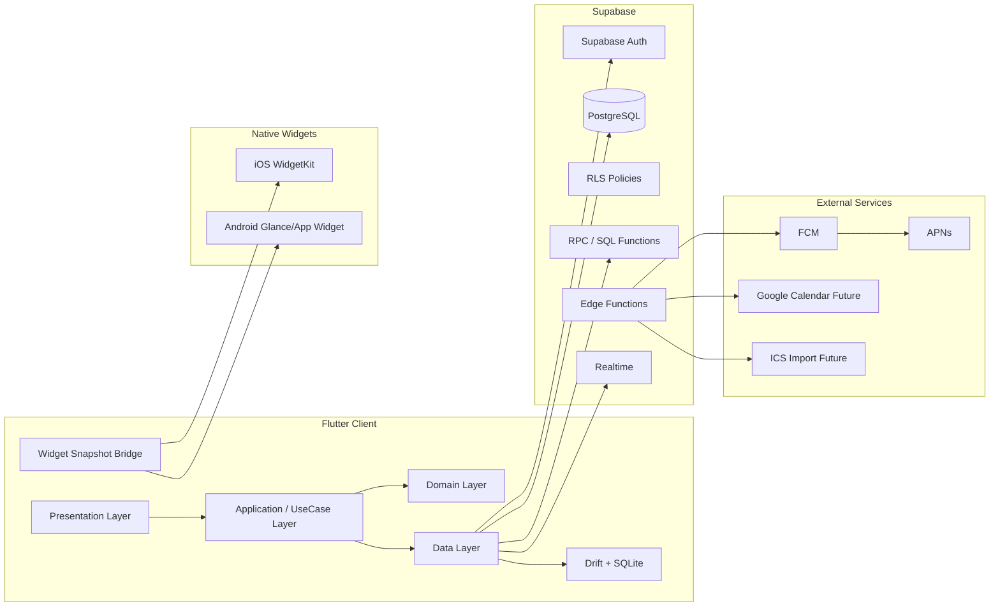
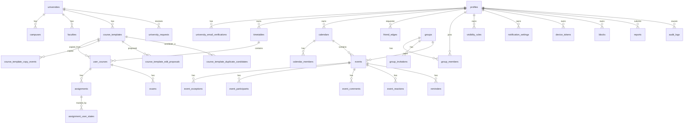

# 大学生向け共有スケジュールアプリ 仕様書 v0.4

作成日: 2026-06-28
対象: iOS / Android
想定技術: Flutter + Supabase + PostgreSQL + Drift/SQLite + FCM/APNs + WidgetKit/Jetpack Glance
目的: MVP 実装に入るためのプロダクト仕様・技術仕様・UI仕様を統合する

---

## 0. この仕様書の位置づけ

この仕様書は、大学生向けの時間割・課題・テスト・予定共有アプリを **実際に開発するための基準文書** である。

対象範囲は以下。

- プロダクト仕様
- MVP スコープ
- 技術スタック
- Flutter アーキテクチャ
- DB / ERD / RLS 設計
- 授業テンプレ共有・コピー・重複排除
- 公開範囲制御
- 予定・繰り返し予定
- オフライン同期
- 通知
- ホーム画面ウィジェット
- UI 仕様
- 管理画面
- セキュリティ・プライバシー
- CI/CD
- テスト戦略
- 開発ロードマップ
- PoC 計画

本仕様では、MVP 時点で過剰な外部連携を避け、まず以下の価値を検証する。

1. 大学生が時間割・課題・テスト・ルーティンを毎週使うか
2. 友だちやグループとの予定共有に価値を感じるか
3. 「見せすぎない共有」によって安心して使えるか
4. 今週の時間割ウィジェットが継続利用のフックになるか

---

## 1. プロダクト概要

### 1.1 アプリの定義

このアプリは、全国の大学生向けの **時間割中心型・共有スケジュール管理アプリ** である。

既存アプリでいうと、以下を統合したものに近い。

- 「すごい時間割」のような授業・課題・テスト・時間割管理
- 「TimeTree」のようなグループカレンダー・予定共有

ただし、単純なカレンダー共有アプリではない。

このアプリの核は、次の 3 点である。

1. **授業起点** で大学生活の予定を束ねる
2. **同じ大学内の授業テンプレを共有・コピー** して時間割登録を速くする
3. **公開範囲を細かく制御** して、友だちやグループに必要な情報だけ見せる

### 1.2 一文での説明

> 大学生が、時間割・課題・テスト・バイト・ジム・友だち予定・グループ予定をまとめて管理し、必要な範囲だけ共有できるアプリ。

### 1.3 想定ユーザー

- 日本の大学生
- 日本の大学院生
- 授業・課題・テストをまとめて管理したい学生
- サークル・ゼミ・研究室・友人グループ・バイト先など複数のグループに所属する学生
- 友だちと空きコマを合わせたい学生
- 予定の中身までは見せたくないが、空いているかどうかは共有したい学生

### 1.4 差別化ポイント

| 差別化軸 | 内容 |
|---|---|
| 授業起点 | 通常のカレンダーではなく、時間割・課題・テストが中心 |
| 同大学内テンプレ | 同じ大学の学生が登録した授業をコピーできる |
| 見せすぎない共有 | `PRIVATE`, `BUSY_ONLY`, `TITLE_ONLY`, `FULL` を使い分ける |
| 空きコマ検索 | 友だち・グループの予定を公開範囲に応じて計算する |
| グループカレンダー | サークル・ゼミ・友人グループの予定を共有する |
| ウィジェット | ホーム画面で今週の時間割を確認できる |

---

## 2. MVP スコープ

### 2.1 MVP に入れる機能

| ID | 機能 | 概要 | MVP |
|---|---|---|---|
| AUTH-01 | 認証 | メール、Google、Apple ログイン | Yes |
| ONB-01 | オンボーディング | ユーザー種別、大学選択、学期設定、時限設定 | Yes |
| UNI-01 | 大学マスタ | 大学選択、大学申請、大学メール認証バッジ | Yes |
| TERM-01 | 学期設定 | 前期/後期、クォーター、任意学期 | Yes |
| PERIOD-01 | 時限設定 | 大学テンプレ + ユーザー編集 | Yes |
| COURSE-01 | 時間割登録 | 手動登録、授業テンプレコピー | Yes |
| COURSE-02 | 授業テンプレ共有 | 同じ大学内で共有 | Yes |
| COURSE-03 | 授業テンプレ検索 | コピー数順・重複候補表示 | Yes |
| ASSIGN-01 | 課題管理 | 締切、提出先 URL、状態、通知 | Yes |
| ASSIGN-02 | 提出完了 | カレンダー上の締切表示を消す | Yes |
| EXAM-01 | テスト管理 | 授業紐付け推奨、授業なしも可 | Yes |
| EVENT-01 | 通常予定 | 個人予定、場所、メモ、通知 | Yes |
| ROUTINE-01 | ルーティン | 毎週、隔週、毎月、第 N 曜日、例外 | Yes |
| SHARE-01 | 公開範囲 | 自分のみ、予定あり、タイトルのみ、詳細 | Yes |
| FRIEND-01 | 友だち追加 | QR、招待リンク、任意 ID 検索 | Yes |
| FRIEND-02 | 友だち時間割 | 公開範囲に応じた表示 | Yes |
| FREE-01 | 空きコマ検索 | 友だち・グループ内対応 | Yes |
| GROUP-01 | グループ作成 | 種別、権限、招待 | Yes |
| GROUP-02 | グループカレンダー | イベント作成、編集、参加回答 | Yes |
| GROUP-03 | コメント | イベント単位コメント | Yes |
| GROUP-04 | リアクション | イベント単位リアクション | Yes |
| NOTIF-01 | 通知 | ローカル通知 + プッシュ通知 | Yes |
| WIDGET-01 | 今週の時間割ウィジェット | 月〜金 × 1〜5 限 | Yes |
| ADMIN-01 | 管理画面 | 大学申請、通報、授業テンプレ統合 | Yes |
| SAFETY-01 | 通報・ブロック | UGC 対応、招待リンク無効化 | Yes |

### 2.2 MVP から外す機能

| 機能 | 外す理由 |
|---|---|
| LMS 自動連携 | 大学・LMS ごとの設定差が大きい |
| シフト自動取得 | バイト先・サービスごとに権限や API が異なる |
| OCR シフト読み取り | 精度・UX・法務リスクが高い |
| 双方向外部カレンダー同期 | 競合解決・削除同期・繰り返し例外が重い |
| 候補日投票 | グループイベント作成後でよい |
| 既読管理 | コメント・リアクションで MVP 価値を検証できる |
| チャット | イベントコメントで代替 |
| ファイル添付 | UGC モデレーションと容量管理が重い |
| 月間カレンダーウィジェット | MVP では今週の時間割に集中する |
| 画像添付 | 通報・ストレージ・審査対応が重い |

---

## 3. 技術スタック

### 3.1 最終推奨構成

```text
Mobile App:
  Flutter

State Management:
  Riverpod

Routing:
  go_router

Model / Serialization:
  freezed
  json_serializable

Local DB:
  Drift + SQLite

Backend:
  Supabase

Database:
  PostgreSQL

Auth:
  Supabase Auth

Realtime:
  Supabase Realtime
  ただし Realtime は同期の主軸ではなく更新通知用途

Server Functions:
  Supabase Edge Functions
  PostgreSQL RPC

Push:
  FCM + APNs

Widget:
  iOS: WidgetKit / SwiftUI
  Android: Jetpack Glance or App Widgets / Kotlin

Admin:
  Next.js + Supabase

CI/CD:
  GitHub Actions
  fastlane
  Supabase CLI
```

### 3.2 技術選定理由

| 領域 | 採用 | 理由 |
|---|---|---|
| モバイル | Flutter | iOS/Android 両対応、UI 開発速度、少人数開発向き |
| 状態管理 | Riverpod | 非同期状態・DI・テスト容易性が高い |
| ローカル DB | Drift | SQL/リレーショナル/型安全/リアクティブクエリに強い |
| バックエンド | Supabase | Postgres + RLS が公開範囲制御と相性が良い |
| DB | PostgreSQL | 予定、授業、グループ、権限がリレーショナル |
| Push | FCM + APNs | iOS/Android 両対応の標準構成 |
| Widget | Native | Flutter 単体ではホーム画面ウィジェットを完結できない |
| Admin | Next.js | CRUD・審査・通報対応の Web 管理画面を作りやすい |

### 3.3 採用しない・MVP では避ける技術

| 技術 | 判断 | 理由 |
|---|---|---|
| React Native | 今回は不採用 | Widget 等は結局ネイティブ実装が必要。Flutter で統一する |
| Firebase Firestore | 不採用寄り | リレーショナル・複雑な権限・SQL 検索には Postgres が向く |
| Realm Sync | 不採用 | Atlas Device Sync / Realm SDK 周辺の将来性に注意が必要 |
| Hive | 補助用途のみ | key-value 寄りで複雑な予定検索に不向き |
| Isar | 不採用寄り | 高速だがサーバ Postgres とのモデル差が大きい |
| 完全自前 API | MVP では避ける | 認証・RLS・Realtime・管理の工数が増える |

---

## 4. 全体アーキテクチャ



### 4.1 基本原則

1. **ローカル DB を画面描画の主軸にする**
   - 画面は Drift の query stream から描画する
   - Supabase から直接 UI を描画し続けない

2. **Supabase Realtime は同期の主軸にしない**
   - Realtime は更新通知の高速化に使う
   - 正本同期は `updated_at` / `version` / `sync_cursor` を使った差分同期

3. **公開範囲はアプリ側だけで隠さない**
   - 見せてはいけない情報をクライアントへ返さない
   - `BUSY_ONLY` や `TITLE_ONLY` は RPC / View で投影する

4. **テンプレと個人データを分ける**
   - `course_templates` は共有元
   - `user_courses` は個人時間割スナップショット

5. **繰り返し予定はルール + 例外で持つ**
   - 全件展開保存を正本にしない
   - 表示や通知に必要な期間だけキャッシュする

---

## 5. Flutter 実装仕様

### 5.1 ディレクトリ構成

```text
lib/
  main.dart
  app/
    app.dart
    router.dart
    theme.dart
    bootstrap.dart
    flavors.dart
  core/
    config/
    constants/
    errors/
    logging/
    network/
    result/
    security/
    time/
    utils/
  shared/
    widgets/
    components/
    extensions/
    validators/
    design_system/
  features/
    auth/
      presentation/
      application/
      domain/
      data/
    onboarding/
    university/
    timetable/
    course_template/
    assignment/
    exam/
    calendar/
    recurrence/
    friend/
    group/
    availability/
    visibility/
    notification/
    widget_sync/
    settings/
    admin_bridge/
  local_db/
    app_database.dart
    tables/
    daos/
    migrations/
  supabase/
    supabase_client_provider.dart
    rpc/
    edge_functions/
  l10n/
  generated/
```

### 5.2 レイヤー責務

| Layer | 責務 |
|---|---|
| presentation | 画面、Widget、フォーム、ユーザー操作 |
| application | UseCase、Riverpod Provider、画面状態、同期操作 |
| domain | Entity、Value Object、Policy、Validation |
| data | Supabase API、Drift DAO、DTO、Mapper |

### 5.3 Riverpod 方針

- `AsyncNotifier` / `Notifier` を基本にする
- 画面ごとに巨大 Provider を作らない
- feature 単位で Provider を分割する
- repository は Provider で注入する
- offline / syncing / conflict の状態を明示する

例:

```dart
final timetableControllerProvider =
    AsyncNotifierProvider<TimetableController, TimetableState>(
  TimetableController.new,
);

class TimetableController extends AsyncNotifier<TimetableState> {
  @override
  Future<TimetableState> build() async {
    final repo = ref.watch(timetableRepositoryProvider);
    return repo.watchCurrentTimetable().first;
  }
}
```

### 5.4 Repository 方針

Repository はローカル DB と Supabase の両方を直接扱う。

```text
UI
 ↓
UseCase / Controller
 ↓
Repository
 ├─ Drift DAO
 ├─ Supabase RPC / Table API
 └─ SyncQueue
```

#### Repository の役割

- ローカル DB から現在状態を返す
- サーバとの差分同期を行う
- オフライン時は `pending_mutations` に積む
- 成功後にローカル DB を確定状態へ更新する
- 競合時に conflict state を返す

### 5.5 エラーハンドリング

エラーは次の分類にする。

```text
NetworkError
AuthError
PermissionError
ValidationError
ConflictError
RateLimitError
ServerError
UnknownError
```

UI では、以下を分けて表示する。

| 状態 | UI |
|---|---|
| 通信不可 | オフラインバナー |
| 同期中 | 小さな同期インジケータ |
| 同期失敗 | 再試行ボタン |
| 権限なし | 共有範囲変更を促す説明 |
| 競合 | 差分確認 UI |

---

## 6. DB 設計

### 6.1 共通カラム

主要テーブルには原則として以下を持つ。

```sql
id uuid primary key default gen_random_uuid(),
created_at timestamptz not null default now(),
updated_at timestamptz not null default now(),
deleted_at timestamptz,
created_by uuid references auth.users(id),
updated_by uuid references auth.users(id),
version bigint not null default 1
```

### 6.2 ERD



### 6.3 主要テーブル

#### profiles

```sql
create table profiles (
  user_id uuid primary key references auth.users(id) on delete cascade,
  display_name text not null,
  username text unique,
  avatar_url text,
  user_type text not null check (user_type in ('undergraduate','graduate','other')),
  university_id uuid references universities(id),
  campus_id uuid references campuses(id),
  faculty_id uuid references faculties(id),
  department_id uuid references departments(id),
  grade int,
  university_verified boolean not null default false,
  searchable_by_username boolean not null default false,
  default_visibility text not null default 'PRIVATE',
  created_at timestamptz not null default now(),
  updated_at timestamptz not null default now(),
  deleted_at timestamptz
);
```

#### universities

```sql
create table universities (
  id uuid primary key default gen_random_uuid(),
  name text not null,
  normalized_name text not null,
  aliases text[] not null default '{}',
  prefecture text,
  domain_hints text[] not null default '{}',
  status text not null default 'active',
  created_at timestamptz not null default now(),
  updated_at timestamptz not null default now()
);

create unique index universities_normalized_name_idx
  on universities(normalized_name);
```

#### university_requests

```sql
create table university_requests (
  id uuid primary key default gen_random_uuid(),
  requested_by uuid not null references auth.users(id),
  name text not null,
  normalized_name text not null,
  prefecture text,
  official_url text,
  status text not null default 'pending'
    check (status in ('pending','approved','rejected','merged')),
  resolved_by uuid references auth.users(id),
  resolved_at timestamptz,
  created_at timestamptz not null default now()
);
```

#### terms

```sql
create table terms (
  id uuid primary key default gen_random_uuid(),
  university_id uuid references universities(id),
  name text not null,
  academic_year int not null,
  start_date date not null,
  end_date date not null,
  term_type text not null check (term_type in ('semester','quarter','custom','intensive','year_round')),
  created_by uuid references auth.users(id),
  is_template boolean not null default false,
  created_at timestamptz not null default now()
);
```

#### period_templates

```sql
create table period_templates (
  id uuid primary key default gen_random_uuid(),
  university_id uuid references universities(id),
  name text not null,
  day_of_week int not null check (day_of_week between 1 and 7),
  period_no int not null check (period_no between 1 and 9),
  start_time time not null,
  end_time time not null,
  is_default boolean not null default false,
  created_by uuid references auth.users(id),
  created_at timestamptz not null default now()
);

create index period_templates_university_idx
  on period_templates(university_id, day_of_week, period_no);
```

#### course_templates

```sql
create table course_templates (
  id uuid primary key default gen_random_uuid(),
  university_id uuid not null references universities(id),
  academic_year int not null,
  term_id uuid references terms(id),
  campus_id uuid references campuses(id),
  faculty_id uuid references faculties(id),
  department_id uuid references departments(id),

  title text not null,
  normalized_title text not null,
  instructor_name text,
  normalized_instructor_name text,
  day_of_week int check (day_of_week between 1 and 7),
  period_no int,
  room text,
  normalized_room text,
  credit_count numeric,
  syllabus_url text,
  external_course_code text,

  created_by uuid references auth.users(id),
  visibility text not null default 'UNIVERSITY',
  status text not null default 'active'
    check (status in ('active','hidden','merged','deleted')),
  canonical_template_id uuid references course_templates(id),

  copy_count_total int not null default 0,
  copy_count_term int not null default 0,
  report_count int not null default 0,
  trust_score numeric not null default 0,

  created_at timestamptz not null default now(),
  updated_at timestamptz not null default now(),
  deleted_at timestamptz,
  version bigint not null default 1
);

create index course_templates_search_idx
  on course_templates(university_id, academic_year, term_id, day_of_week, period_no);

create index course_templates_normalized_idx
  on course_templates(university_id, normalized_title, normalized_instructor_name);
```

#### user_courses

```sql
create table user_courses (
  id uuid primary key default gen_random_uuid(),
  user_id uuid not null references auth.users(id),
  timetable_id uuid not null references timetables(id),
  source_template_id uuid references course_templates(id),

  title text not null,
  instructor_name text,
  day_of_week int not null check (day_of_week between 1 and 7),
  period_no int not null,
  start_time time,
  end_time time,
  room text,
  credit_count numeric,
  online_url text,
  memo text,
  color_key text,
  visibility_default text not null default 'PRIVATE',

  created_at timestamptz not null default now(),
  updated_at timestamptz not null default now(),
  deleted_at timestamptz,
  version bigint not null default 1
);

create index user_courses_timetable_idx
  on user_courses(user_id, timetable_id, day_of_week, period_no);
```

#### assignments

```sql
create table assignments (
  id uuid primary key default gen_random_uuid(),
  course_id uuid references user_courses(id),
  created_by uuid not null references auth.users(id),
  title text not null,
  description text,
  due_at timestamptz not null,
  submit_url text,
  priority text not null default 'normal'
    check (priority in ('low','normal','high')),
  visibility_default text not null default 'PRIVATE',
  shared_scope text not null default 'personal'
    check (shared_scope in ('personal','group','course')),
  calendar_projection_enabled boolean not null default true,
  created_at timestamptz not null default now(),
  updated_at timestamptz not null default now(),
  deleted_at timestamptz,
  version bigint not null default 1
);

create index assignments_due_idx on assignments(created_by, due_at);
```

#### assignment_user_states

```sql
create table assignment_user_states (
  assignment_id uuid not null references assignments(id) on delete cascade,
  user_id uuid not null references auth.users(id),
  status text not null default 'not_started'
    check (status in ('not_started','in_progress','submitted','overdue','archived')),
  submitted_at timestamptz,
  hidden_from_calendar boolean not null default false,
  updated_at timestamptz not null default now(),
  primary key (assignment_id, user_id)
);
```

#### events

```sql
create table events (
  id uuid primary key default gen_random_uuid(),
  calendar_id uuid references calendars(id),
  owner_user_id uuid references auth.users(id),
  group_id uuid references groups(id),
  source_type text not null default 'manual'
    check (source_type in ('manual','course','assignment_deadline','exam','routine','shift','group_event','external')),
  source_ref_id uuid,

  title text not null,
  description text,
  location text,
  start_at timestamptz not null,
  end_at timestamptz not null,
  is_all_day boolean not null default false,
  timezone text not null default 'Asia/Tokyo',

  recurrence_rule text,
  recurrence_end_at timestamptz,
  recurrence_count int,

  visibility_default text not null default 'PRIVATE'
    check (visibility_default in ('PRIVATE','BUSY_ONLY','TITLE_ONLY','FULL')),
  status text not null default 'confirmed'
    check (status in ('tentative','confirmed','cancelled')),

  created_by uuid references auth.users(id),
  updated_by uuid references auth.users(id),
  created_at timestamptz not null default now(),
  updated_at timestamptz not null default now(),
  deleted_at timestamptz,
  version bigint not null default 1
);

create index events_owner_range_idx on events(owner_user_id, start_at, end_at);
create index events_calendar_range_idx on events(calendar_id, start_at, end_at);
create index events_group_range_idx on events(group_id, start_at, end_at);
```

#### event_exceptions

```sql
create table event_exceptions (
  id uuid primary key default gen_random_uuid(),
  event_id uuid not null references events(id) on delete cascade,
  recurrence_id timestamptz not null,
  action text not null check (action in ('delete','override')),
  override_title text,
  override_description text,
  override_location text,
  override_start_at timestamptz,
  override_end_at timestamptz,
  created_by uuid references auth.users(id),
  created_at timestamptz not null default now(),
  updated_at timestamptz not null default now(),
  unique(event_id, recurrence_id)
);
```

#### visibility_rules

```sql
create table visibility_rules (
  id uuid primary key default gen_random_uuid(),
  owner_user_id uuid not null references auth.users(id),
  target_type text not null
    check (target_type in ('event','calendar','course','assignment','default')),
  target_id uuid,
  principal_type text not null
    check (principal_type in ('friend','group','user')),
  principal_id uuid not null,
  visibility_level text not null
    check (visibility_level in ('PRIVATE','BUSY_ONLY','TITLE_ONLY','FULL')),
  created_at timestamptz not null default now(),
  updated_at timestamptz not null default now(),
  unique(owner_user_id, target_type, target_id, principal_type, principal_id)
);
```

#### groups / group_members

```sql
create table groups (
  id uuid primary key default gen_random_uuid(),
  name text not null,
  group_type text not null
    check (group_type in ('friend','course','circle','seminar','lab','part_time_job','other')),
  description text,
  default_event_create_role text not null default 'member'
    check (default_event_create_role in ('owner','admin','member')),
  created_by uuid not null references auth.users(id),
  created_at timestamptz not null default now(),
  updated_at timestamptz not null default now(),
  deleted_at timestamptz
);

create table group_members (
  group_id uuid not null references groups(id) on delete cascade,
  user_id uuid not null references auth.users(id),
  role text not null check (role in ('owner','admin','member')),
  status text not null default 'active'
    check (status in ('active','invited','left','removed')),
  joined_at timestamptz,
  left_at timestamptz,
  primary key (group_id, user_id)
);
```

#### event_comments / event_reactions

```sql
create table event_comments (
  id uuid primary key default gen_random_uuid(),
  event_id uuid not null references events(id) on delete cascade,
  author_user_id uuid not null references auth.users(id),
  body text not null,
  created_at timestamptz not null default now(),
  updated_at timestamptz not null default now(),
  deleted_at timestamptz
);

create table event_reactions (
  id uuid primary key default gen_random_uuid(),
  event_id uuid not null references events(id) on delete cascade,
  user_id uuid not null references auth.users(id),
  reaction_type text not null
    check (reaction_type in ('ok','thanks','question','maybe','cannot')),
  created_at timestamptz not null default now(),
  unique(event_id, user_id, reaction_type)
);
```

#### pending_mutations

サーバ側ではなく、基本はローカル Drift 側に持つ。

```sql
-- Drift local table
pending_mutations (
  id text primary key,
  entity_type text not null,
  entity_id text not null,
  operation text not null,
  payload text not null,
  base_version integer,
  status text not null,
  created_at text not null,
  last_error text
)
```

### 6.4 インデックス方針

| 対象 | インデックス |
|---|---|
| events | `(owner_user_id, start_at, end_at)` |
| events | `(calendar_id, start_at, end_at)` |
| events | `(group_id, start_at, end_at)` |
| assignments | `(created_by, due_at)` |
| user_courses | `(user_id, timetable_id, day_of_week, period_no)` |
| course_templates | `(university_id, academic_year, term_id, day_of_week, period_no)` |
| course_templates | `(university_id, normalized_title, normalized_instructor_name)` |
| group_members | `(group_id, user_id)` |
| visibility_rules | `(owner_user_id, target_type, target_id)` |
| visibility_rules | `(principal_type, principal_id)` |
| event_comments | `(event_id, created_at)` |

---

## 7. RLS / 権限設計

### 7.1 基本方針

RLS は以下を守るために使う。

- 自分の原本予定だけ直読できる
- グループ予定はメンバーだけ読める
- 授業テンプレは同じ大学のユーザーだけ読める
- 課題提出状態は本人だけ読める
- コメントはイベント閲覧権限がある人だけ読める
- 管理用情報はクライアントから直接読ませない

### 7.2 重要原則

`BUSY_ONLY` や `TITLE_ONLY` の予定について、原本 `events` の全列をクライアントへ返してからアプリ側で隠す設計は禁止する。

代わりに以下を使う。

- 原本 `events` は本人・編集権限者のみ直接 read
- 他人が見る予定は `rpc_get_visible_events` から redacted projection として返す
- `PRIVATE` は返さない
- `BUSY_ONLY` はタイトルを `予定あり` に置換する
- `TITLE_ONLY` はタイトル・時間・種別だけ返す
- `FULL` は詳細まで返す

### 7.3 表示投影ルール

| visibility | start/end | title | kind | location | description | URL |
|---|---|---|---|---|---|---|
| PRIVATE | hidden | hidden | hidden | hidden | hidden | hidden |
| BUSY_ONLY | visible | 予定あり | hidden | hidden | hidden | hidden |
| TITLE_ONLY | visible | visible | visible | hidden | hidden | hidden |
| FULL | visible | visible | visible | visible | visible | visible |

### 7.4 RPC 例

```sql
create or replace function app.get_visible_events(
  p_viewer uuid,
  p_start timestamptz,
  p_end timestamptz
)
returns table (
  event_id uuid,
  start_at timestamptz,
  end_at timestamptz,
  title text,
  kind text,
  location text,
  description text,
  visibility_level text,
  owner_user_id uuid,
  group_id uuid
)
language plpgsql
security definer
set search_path = app, public
as $$
begin
  return query
  with candidate_events as (
    select e.*
    from events e
    where e.deleted_at is null
      and e.start_at < p_end
      and e.end_at > p_start
      and (
        e.owner_user_id = p_viewer
        or exists (
          select 1 from group_members gm
          where gm.group_id = e.group_id
            and gm.user_id = p_viewer
            and gm.status = 'active'
        )
        or exists (
          select 1 from friend_edges f
          where f.status = 'accepted'
            and (
              (f.user_id = p_viewer and f.friend_user_id = e.owner_user_id)
              or
              (f.friend_user_id = p_viewer and f.user_id = e.owner_user_id)
            )
        )
      )
  ), resolved as (
    select
      e.*,
      app.resolve_visibility(p_viewer, e.id, e.owner_user_id, e.group_id, e.visibility_default) as resolved_visibility
    from candidate_events e
  )
  select
    r.id,
    r.start_at,
    r.end_at,
    case
      when r.resolved_visibility = 'BUSY_ONLY' then '予定あり'
      when r.resolved_visibility in ('TITLE_ONLY','FULL') then r.title
      when r.owner_user_id = p_viewer then r.title
      else null
    end as title,
    case
      when r.resolved_visibility in ('TITLE_ONLY','FULL') or r.owner_user_id = p_viewer then r.source_type
      else null
    end as kind,
    case
      when r.resolved_visibility = 'FULL' or r.owner_user_id = p_viewer then r.location
      else null
    end as location,
    case
      when r.resolved_visibility = 'FULL' or r.owner_user_id = p_viewer then r.description
      else null
    end as description,
    r.resolved_visibility,
    r.owner_user_id,
    r.group_id
  from resolved r
  where r.owner_user_id = p_viewer
     or r.resolved_visibility in ('BUSY_ONLY','TITLE_ONLY','FULL');
end;
$$;
```

### 7.5 RLS ポリシー例

#### profiles

```sql
alter table profiles enable row level security;

create policy "profiles_select_self"
on profiles for select
to authenticated
using (user_id = auth.uid());

create policy "profiles_update_self"
on profiles for update
to authenticated
using (user_id = auth.uid())
with check (user_id = auth.uid());
```

#### user_courses

```sql
alter table user_courses enable row level security;

create policy "user_courses_owner_all"
on user_courses for all
to authenticated
using (user_id = auth.uid())
with check (user_id = auth.uid());
```

#### course_templates

```sql
alter table course_templates enable row level security;

create policy "same_university_can_read_course_templates"
on course_templates for select
to authenticated
using (
  exists (
    select 1 from profiles p
    where p.user_id = auth.uid()
      and p.university_id = course_templates.university_id
  )
  and status = 'active'
  and deleted_at is null
);
```

#### assignment_user_states

```sql
alter table assignment_user_states enable row level security;

create policy "assignment_state_self"
on assignment_user_states for all
to authenticated
using (user_id = auth.uid())
with check (user_id = auth.uid());
```

#### group_members

```sql
alter table group_members enable row level security;

create policy "group_members_visible_to_group"
on group_members for select
to authenticated
using (
  exists (
    select 1 from group_members gm
    where gm.group_id = group_members.group_id
      and gm.user_id = auth.uid()
      and gm.status = 'active'
  )
);
```

### 7.6 RLS テスト方針

最低限、以下のユーザーを seed する。

```text
user_a: 予定所有者
user_b: 友だち
user_c: 同じグループ
user_d: ブロック済み
user_e: 無関係
admin: 管理者
```

テストケース:

- `PRIVATE` 予定は本人以外に出ない
- `BUSY_ONLY` は「予定あり」として返る
- `TITLE_ONLY` は場所・メモを返さない
- `FULL` は詳細まで返る
- ブロック済みユーザーには返らない
- グループ脱退後、個人予定は見えない
- グループイベント履歴の扱いが仕様通り

---

## 8. 授業テンプレ設計

### 8.1 基本仕様

授業テンプレは、**同じ大学内だけで共有**する。

```text
全国の大学生が使える
ただし授業検索・コピーは自分の大学内のみ
```

ユーザーが授業を手動登録した場合、初期値 ON で同じ大学の他ユーザーがコピー可能なテンプレとして登録する。

```text
[ON] 同じ大学の人がこの授業をコピーできるようにする
```

作成者名は表示しない。

### 8.2 コピー時の扱い

`course_templates` を直接参照し続けない。

コピー時に `user_courses` を作成する。

```text
CourseTemplate
  ↓ copy
UserCourse
```

テンプレ更新は自動反映しない。

```text
テンプレ更新あり
  ↓
コピー済みユーザーに通知
  ↓
反映する / 無視する を選択
```

### 8.3 正規化仕様

#### 授業名

```text
1. Unicode NFKC 正規化
2. 全角英数字を半角化
3. 大文字小文字統一
4. 前後空白削除
5. 連続空白を 1 つに圧縮
6. 比較用キーでは空白削除
7. 記号の揺れ吸収
8. ローマ数字の揺れ吸収
   Ⅰ / I / 1
   Ⅱ / II / 2
   Ⅲ / III / 3
```

#### 教員名

```text
1. NFKC 正規化
2. 空白削除
3. 敬称削除
   先生
   教授
   准教授
   講師
   助教
4. 大文字小文字統一
```

#### Dart 実装例

```dart
String normalizeCourseTitle(String input) {
  var s = nfkc(input); // パッケージまたは自前実装を検証
  s = s.toLowerCase();
  s = s.trim();
  s = s.replaceAll(RegExp(r'\s+'), '');
  s = s.replaceAll('Ⅰ', '1');
  s = s.replaceAll('Ⅱ', '2');
  s = s.replaceAll('Ⅲ', '3');
  s = s.replaceAll('Ⅳ', '4');
  s = s.replaceAll('Ⅴ', '5');
  s = s.replaceAll(RegExp(r'[・･/／\-ー―]'), '');
  return s;
}

String normalizeInstructorName(String input) {
  var s = nfkc(input);
  s = s.trim().replaceAll(RegExp(r'\s+'), '');
  s = s.replaceAll(RegExp(r'(先生|教授|准教授|講師|助教)$'), '');
  return s.toLowerCase();
}
```

### 8.4 重複候補判定

#### Level 1: 強い重複候補

```text
university_id
academic_year
term_id
normalized_title
normalized_instructor_name
day_of_week
period_no
```

#### Level 2: 中程度

```text
university_id
academic_year
term_id
normalized_title
day_of_week
period_no
```

#### Level 3: 参考候補

```text
university_id
normalized_title
normalized_instructor_name
```

#### Level 4: 類似文字列

PostgreSQL の `pg_trgm` や `levenshtein` を検討する。

```sql
select id, title, instructor_name, day_of_week, period_no,
       similarity(normalized_title, :normalized_title) as score
from course_templates
where university_id = :university_id
  and status = 'active'
  and normalized_title % :normalized_title
order by score desc
limit 10;
```

### 8.5 ランキングスコア

```text
score =
  log(1 + copy_count_term) * 5
  + log(1 + copy_count_total) * 2
  + same_campus_bonus
  + same_faculty_bonus
  + verified_user_copy_bonus
  + admin_verified_bonus
  - report_count * 5
  - stale_penalty
```

### 8.6 検索結果 UI

```text
情報システムデザイン
金曜1限 / 山田先生 / B棟201
2026年度前期で 34人がコピー
総コピー数 86

[コピー]
```

重複候補がある場合:

```text
似た授業があります

情報システムデザイン
金曜1限 / 山田先生 / B棟201
34人がコピー

[この授業をコピー]
[別の授業として登録]
```

---

## 9. 予定・繰り返し予定仕様

### 9.1 予定種別

```text
course
assignment_deadline
exam
personal
routine
shift
group_event
external
```

### 9.2 RRULE 対応範囲

MVP では以下に対応する。

```text
毎日
毎週
隔週
毎月
毎月第 N 曜日
平日のみ
開始日
終了日
一回だけ変更
一回だけ削除
```

### 9.3 保存方式

```text
events:
  繰り返し親イベント

recurrence_rule:
  FREQ=WEEKLY;INTERVAL=2;BYDAY=MO

event_exceptions:
  一回だけ削除
  一回だけ変更
```

### 9.4 RRULE 例

```text
毎週月曜:
  FREQ=WEEKLY;BYDAY=MO

隔週水曜:
  FREQ=WEEKLY;INTERVAL=2;BYDAY=WE

毎月第2水曜:
  FREQ=MONTHLY;BYDAY=WE;BYSETPOS=2

平日のみ:
  FREQ=WEEKLY;BYDAY=MO,TU,WE,TH,FR
```

### 9.5 occurrence 展開方針

- 正本は `events.recurrence_rule` と `event_exceptions`
- 表示時に必要期間だけ展開
- ウィジェット用には 2〜4 週間分を snapshot 化
- 通知用には 30〜60 日分を予約対象にする
- 長期キャッシュは `event_occurrence_cache` に保存してもよい

### 9.6 展開疑似コード

```text
function expandOccurrences(event, rangeStart, rangeEnd):
  if event.recurrence_rule is null:
    if overlaps(event, rangeStart, rangeEnd): return [event]
    else return []

  baseOccurrences = rrule.expand(event.start_at, event.recurrence_rule, rangeStart, rangeEnd)
  exceptions = loadExceptions(event.id, rangeStart, rangeEnd)

  result = []
  for occ in baseOccurrences:
    ex = exceptions.findByRecurrenceId(occ.start_at)
    if ex.action == 'delete':
      continue
    if ex.action == 'override':
      result.add(applyOverride(occ, ex))
    else:
      result.add(occ)

  return result
```

---

## 10. 課題・テスト仕様

### 10.1 課題の基本方針

課題は「タスク本体 + カレンダー締切表示」として扱う。

```text
Assignment:
  課題本体

AssignmentUserState:
  ユーザーごとの提出状態

Calendar Projection:
  締切表示
```

### 10.2 課題ステータス

```text
not_started
in_progress
submitted
overdue
archived
```

### 10.3 提出完了時の挙動

```text
提出完了ボタン
  ↓
assignment_user_states.status = submitted
assignment_user_states.submitted_at = now()
assignment_user_states.hidden_from_calendar = true
  ↓
カレンダー上の締切表示を消す
  ↓
課題履歴は残す
```

### 10.4 共有課題

共有される情報:

```text
課題名
締切
提出先 URL
メモ
対象授業
```

共有しない情報:

```text
自分が提出済みか
自分の進捗
個人メモ
```

### 10.5 テスト

> 2026-09-18 Phase 4 UI方針追記（本人の選好を優先）: 通常の課題作成・編集は一画面入力とし、提出先URLの入力欄を設けない。新規URLは未設定で保存し、既存のURL・公開範囲・個人の提出状態など入力対象外の値は編集で保持する。URL列や取り込み互換性は削除しない。URLのある課題だけ外部の提出先を開ける。外部ページを開く操作と、一覧から「提出済みを記録」する内部操作は区別する。Todayは締切のまとまり→当日の授業の時系列を採用する。これは本人のプロダクト選好であり、複数利用者の効果検証を意味しない。実装と検証範囲は `docs/TESTING.md` を参照。

テストは授業紐付け推奨だが、授業なしでも作成可能。

```text
授業あり:
  中間試験
  期末試験
  小テスト
  発表
  レポート

授業なし:
  TOEIC
  資格試験
  外部試験
```

---

## 11. オフライン同期仕様

### 11.1 MVP 対応範囲

| 操作 | オフライン |
|---|---|
| 時間割閲覧 | Yes |
| 課題閲覧 | Yes |
| テスト閲覧 | Yes |
| 個人予定閲覧 | Yes |
| 個人予定作成・編集 | Yes |
| 個人課題状態更新 | Yes |
| グループ予定作成・編集 | No |
| 友だち追加 | No |
| 公開範囲変更 | No |
| 授業テンプレ投稿 | No |

### 11.2 sync_queue

ローカル Drift に `pending_mutations` を持つ。

```text
id
entity_type
entity_id
operation
payload
base_version
status
created_at
last_error
```

### 11.3 同期手順

```text
1. UI 操作
2. ローカル DB に optimistic update
3. pending_mutations に積む
4. ネットワーク復帰
5. mutation を順番に送信
6. version が一致すれば成功
7. 成功したら pending を削除
8. 競合したら conflict state にする
```

### 11.4 競合方針

| 対象 | 方針 |
|---|---|
| 個人予定 | Last Write Wins で可 |
| 個人課題状態 | Last Write Wins で可 |
| 個人時間割 | Last Write Wins で可 |
| グループイベント | version conflict を検出 |
| コメント | 追記型なので競合しにくい |
| 参加回答 | ユーザーごとに上書き |
| 公開範囲 | オンライン必須 |

### 11.5 同期疑似コード

```text
function syncPendingMutations():
  mutations = localDb.pendingMutations.orderBy(created_at)

  for mutation in mutations:
    try:
      response = api.applyMutation(mutation)
      localDb.transaction:
        localDb.upsert(response.entity)
        localDb.deletePendingMutation(mutation.id)
    catch ConflictError as e:
      localDb.markConflict(mutation.id, e.serverEntity)
    catch NetworkError:
      break
    catch Error as e:
      localDb.markFailed(mutation.id, e.message)
```

### 11.6 初回同期

```text
1. profiles
2. universities / period templates
3. current timetable
4. assignments / exams
5. events in range: now - 30 days to now + 180 days
6. groups / friends
7. visibility settings
```

### 11.7 差分同期

すべての同期対象テーブルに `updated_at`, `deleted_at`, `version` を持たせる。

```text
GET /sync?since=cursor
```

または Supabase RPC:

```sql
select * from app.get_sync_delta(:user_id, :since);
```

---

## 12. 通知仕様

### 12.1 通知方式

| 種類 | 方式 |
|---|---|
| 授業開始前 | ローカル通知 |
| 課題締切 | ローカル通知 |
| テスト前 | ローカル通知 |
| バイト・ルーティン前 | ローカル通知 |
| グループ招待 | プッシュ通知 |
| グループイベント作成 | プッシュ通知 |
| グループイベント変更 | プッシュ通知 |
| コメント | プッシュ通知 |
| リアクション | 通知しない |

### 12.2 初期通知設定

```text
授業:
  開始 10 分前

課題:
  前日 20:00
  当日 3 時間前

テスト:
  1 週間前
  前日 20:00
  当日朝

グループイベント:
  前日 20:00
  開始 1 時間前

バイト / ルーティン:
  開始 1 時間前
```

### 12.3 通知許可 UX

初回起動直後には通知許可を求めない。

```text
授業登録
  ↓
課題または予定登録
  ↓
「締切前に通知できます」説明
  ↓
通知許可ダイアログ
```

### 12.4 notification_settings

```sql
create table notification_settings (
  id uuid primary key default gen_random_uuid(),
  user_id uuid not null references auth.users(id),
  target_type text not null,
  target_id uuid,
  enabled boolean not null default true,
  rules jsonb not null default '[]'::jsonb,
  quiet_hours_start time,
  quiet_hours_end time,
  created_at timestamptz not null default now(),
  updated_at timestamptz not null default now()
);
```

### 12.5 device_tokens

```sql
create table device_tokens (
  id uuid primary key default gen_random_uuid(),
  user_id uuid not null references auth.users(id),
  platform text not null check (platform in ('ios','android')),
  token text not null,
  app_version text,
  device_id text,
  enabled boolean not null default true,
  created_at timestamptz not null default now(),
  updated_at timestamptz not null default now(),
  unique(user_id, token)
);
```

---

## 13. ホーム画面ウィジェット仕様

### 13.1 MVP ウィジェット

MVP では **今週の時間割ウィジェット** のみ作る。

作らないもの:

```text
小サイズ: 今日の次の授業
中サイズ: 今日の時間割
```

### 13.2 表示仕様

```text
月〜金
1限〜5限
授業カード
空きコマ
現在曜日の強調
```

### 13.3 サイズ

| OS | サイズ |
|---|---|
| iOS | Large Widget |
| Android | 4x4 以上推奨 |

### 13.4 表示項目

```text
曜日ヘッダー
時限ラベル
授業名
教室 任意
現在曜日の強調
空きコマ
```

### 13.5 タップ挙動

| タップ対象 | 遷移先 |
|---|---|
| 授業カード | 授業詳細 |
| 空きコマ | 授業追加画面 |
| ヘッダー | 時間割画面 |

### 13.6 Widget Snapshot

Flutter アプリが表示用 JSON を生成し、ネイティブ Widget が読む。

```json
{
  "mode": "timetable_week",
  "weekStart": "2026-06-29",
  "timezone": "Asia/Tokyo",
  "days": ["月", "火", "水", "木", "金"],
  "periods": [
    { "no": 1, "start": "08:40", "end": "10:20" },
    { "no": 2, "start": "10:35", "end": "12:15" }
  ],
  "items": [
    {
      "courseId": "...",
      "dayOfWeek": 1,
      "periodNo": 1,
      "title": "データサイエンス",
      "room": "B201",
      "colorKey": "course_blue",
      "deepLink": "app://course/..."
    }
  ],
  "privacyMode": "title"
}
```

### 13.7 更新タイミング

```text
アプリ起動時
時間割変更時
学期切替時
日付変更時
OS が許す範囲の定期更新
```

### 13.8 後続ウィジェット

v0.4 以降で追加候補。

```text
1週間スケジュールウィジェット
  7日 × 予定リスト
  授業、バイト、ジム、グループ予定を表示
```

---

## 14. Deep Link / App Link / Universal Link

### 14.1 URL 設計

```text
app://home
app://timetable
app://course/{courseId}
app://assignment/{assignmentId}
app://exam/{examId}
app://event/{eventId}
app://group/{groupId}
app://group/{groupId}/event/{eventId}
app://friend/{userId}
app://settings/visibility
```

公開リンク:

```text
https://example.com/invite/friend/{token}
https://example.com/invite/group/{token}
https://example.com/course-template/{templateId}
```

### 14.2 招待リンク仕様

```sql
create table group_invitations (
  id uuid primary key default gen_random_uuid(),
  group_id uuid not null references groups(id),
  token_hash text not null unique,
  created_by uuid not null references auth.users(id),
  expires_at timestamptz,
  max_uses int,
  used_count int not null default 0,
  revoked_at timestamptz,
  created_at timestamptz not null default now()
);
```

### 14.3 未ログイン時の処理

```text
リンクを開く
  ↓
未ログインならログイン画面
  ↓
ログイン後、pending deep link を復元
  ↓
招待確認画面へ
```

---

## 15. UI 仕様

### 15.1 UI コンセプト

```text
登録を速くする
予定の全体像をすぐ見せる
共有範囲を常に見えるようにする
大学生の語彙で表示する
色だけに頼らない
```

### 15.2 ボトムナビゲーション

MVP は 5 タブ。

```text
ホーム
時間割
課題・テスト
カレンダー
共有
```

設定は右上プロフィールアイコンから入る。

### 15.3 グローバル追加ボタン

右下に `+` を配置し、ボトムシートを開く。

```text
授業を追加
課題を追加
テストを追加
予定を追加
ルーティンを追加
グループイベントを追加
```

文脈に応じて並び順を変える。

### 15.4 デザインシステム

#### カラー分類

| 種別 | 色の方向 |
|---|---|
| 授業 | 水色系 |
| 課題 | 赤・橙系 |
| テスト | 紫系 |
| 個人予定 | 緑系 |
| バイト・ルーティン | 黄・茶系 |
| グループ予定 | グループカラー |
| 外部予定 | グレー系 |

色だけで区別せず、アイコンとラベルを併用する。

#### 主要コンポーネント

```text
CourseCard
EventChip
AssignmentRow
ExamCard
PrivacyBadge
CopyCountBadge
GroupEventCard
ReactionBar
CommentList
QuickAddSheet
VisibilityPreview
SyncStatusBanner
EmptyState
ErrorState
OfflineBanner
```

### 15.5 画面仕様

#### オンボーディング

画面順:

```text
ログイン / 登録
ユーザー種別選択
大学選択
キャンパス・学部・学科 任意
学期設定
時限設定
最初の授業登録
通知説明
ホーム
```

#### ホーム

表示要素:

```text
日付
学期名
今日の授業数
今日の課題
今日のグループ予定
直近課題
直近テスト
今週の時間割ミニカード
グループ更新
空きコマ検索 CTA
```

#### 時間割画面

初期表示:

```text
月〜金
1〜5限
```

設定で拡張:

```text
土曜表示
日曜表示
6限表示
7限表示
```

操作:

| 操作 | 挙動 |
|---|---|
| 空きコマタップ | 授業検索/追加 |
| 授業タップ | 授業詳細 |
| 授業長押し | 移動・コピー・削除 |
| 学期切替 | 対象学期へ |

#### 授業検索/コピー画面

構成:

```text
検索バー
曜日フィルタ
時限フィルタ
教員フィルタ
コピー数順リスト
手動登録ボタン
```

#### 授業詳細

タブ:

```text
概要
課題
テスト
メモ
共有
```

#### 課題一覧

表示切替:

```text
未提出
今日
今週
授業別
提出済み
```

課題カード:

```text
課題名
授業名
締切
残り時間
状態
提出完了ボタン
```

#### カレンダー画面

表示モード:

```text
月
週
日
リスト
```

フィルタ:

```text
授業
課題
テスト
個人予定
バイト
グループ
外部予定
```

#### 共有画面

タブ:

```text
友だち
グループ
空きコマ検索
```

#### 友だち時間割

相手の公開範囲に応じて表示。

```text
FULL: 授業名、教室、教員
TITLE_ONLY: 授業名のみ
BUSY_ONLY: 予定あり
PRIVATE: 空きとして見える
```

#### グループ詳細

タブ:

```text
予定
メンバー
情報
```

#### グループイベント詳細

表示:

```text
イベント名
日時
場所
説明
参加回答
参加者一覧
コメント
リアクション
公開範囲
通知設定
```

参加回答:

```text
参加
不参加
未定
未回答
```

リアクション:

```text
了解
ありがとう
質問
参加できそう
厳しい
```

#### 公開範囲設定

表示:

```text
デフォルト公開範囲
友だちごとの公開範囲
グループごとの公開範囲
予定種別ごとの公開範囲
プレビュー
ブロックリスト
```

公開範囲説明:

```text
自分のみ:
  誰にも表示しません

予定ありのみ:
  時間だけ埋まって表示されます

タイトルのみ:
  タイトルと時間だけ表示されます

詳細まで:
  場所やメモも表示されます
```

---

## 16. グループカレンダー仕様

### 16.1 グループ種別

```text
友人
授業
サークル
ゼミ
研究室
バイト
その他
```

### 16.2 権限

| 権限 | できること |
|---|---|
| Owner | グループ削除、Owner 移譲、Admin 管理 |
| Admin | 招待、メンバー管理、予定編集、通報対応 |
| Member | 予定閲覧、予定作成、参加回答、コメント、リアクション |

イベント作成権限はグループごとに設定可能。

```text
全員
Admin 以上
Owner のみ
```

初期値は `全員`。

### 16.3 グループイベント編集

編集できる人:

```text
作成者
Admin
Owner
```

### 16.4 コメント

MVP で可能:

```text
投稿
編集
削除
通報
```

MVP で不可:

```text
返信スレッド
画像添付
ファイル添付
メンション
既読管理
```

### 16.5 リアクション

固定プリセット:

```text
ok
thanks
question
maybe
cannot
```

リアクションのみでは通知しない。

---

## 17. 管理画面仕様

### 17.1 技術

推奨:

```text
Next.js + Supabase
```

### 17.2 管理機能

| 機能 | MVP |
|---|---|
| 大学マスタ管理 | Yes |
| 大学申請承認 | Yes |
| 授業テンプレ検索 | Yes |
| 授業テンプレ通報確認 | Yes |
| 重複候補確認 | Yes |
| テンプレ統合 | Yes |
| 修正提案確認 | Yes |
| コメント通報確認 | Yes |
| ユーザー通報確認 | Yes |
| ユーザー停止 | Yes |
| グループ通報確認 | Yes |
| 問い合わせ管理 | Should |
| 利用分析 | Later |

### 17.3 テンプレ統合フロー

```text
重複候補一覧
  ↓
管理者が比較
  ↓
canonical template を選択
  ↓
非 canonical を merged に変更
  ↓
今後の検索結果では canonical を表示
  ↓
既存 user_courses は自動変更しない
```

### 17.4 通報対応

```text
通報受信
  ↓
対象確認
  ↓
対応選択
    - 何もしない
    - 非表示
    - 警告
    - ユーザー停止
    - グループ停止
  ↓
audit_logs に記録
```

---

## 18. セキュリティ・プライバシー仕様

### 18.1 基本方針

このアプリは、大学名、授業、教室、バイト予定、友人関係、グループ所属を扱うため、生活パターンが推測されやすい。

そのため、公開範囲の初期値は必ず `PRIVATE` とする。

### 18.2 必須対策

```text
RLS 有効化
service_role key をクライアントに置かない
OAuth トークンを安全に保存
iOS Keychain / Android Keystore を利用
アカウント削除導線
データ削除導線
通報
ブロック
招待リンク無効化
公開範囲プレビュー
ログに個人情報を出さない
```

### 18.3 UGC 対応

UGC 対象:

```text
授業テンプレ
イベントコメント
リアクション
グループ名
イベント名
```

必要機能:

```text
通報
ブロック
モデレーション
不適切コンテンツ非表示
ユーザー停止
管理者連絡先
```

### 18.4 ブロック仕様

```sql
create table blocks (
  blocker_user_id uuid not null references auth.users(id),
  blocked_user_id uuid not null references auth.users(id),
  created_at timestamptz not null default now(),
  primary key (blocker_user_id, blocked_user_id)
);
```

ブロック時:

```text
相互にプロフィール検索結果へ出さない
個人予定を表示しない
友だち申請を送れない
コメント通知を送らない
既存グループ内では最低限の表示にする
```

---

## 19. CI/CD・開発環境

### 19.1 リポジトリ構成

```text
repo/
  apps/
    mobile/
    admin/
  supabase/
    migrations/
    functions/
    seed.sql
    tests/
  packages/
    shared_types/
  docs/
    spec/
    adr/
    api/
```

### 19.2 ブランチ戦略

```text
main:
  production

develop:
  staging

feature/*:
  機能開発

hotfix/*:
  緊急修正
```

### 19.3 CI

```text
pull request:
  flutter analyze
  dart format check
  unit tests
  widget tests
  drift codegen check
  supabase migration check
  SQL lint

merge to develop:
  staging build
  Supabase staging migration
  TestFlight / Google Play Internal 配布

merge to main:
  production build
  manual approval
  store submit
```

### 19.4 環境分離

```text
local
staging
production
```

環境変数:

```text
SUPABASE_URL
SUPABASE_ANON_KEY
SENTRY_DSN
FCM_CONFIG
APP_ENV
```

---

## 20. テスト戦略

### 20.1 優先度高

| テスト | 内容 |
|---|---|
| RLS テスト | 公開範囲ごとの見え方 |
| RRULE テスト | 隔週、第 N 曜日、例外削除・変更 |
| 授業正規化テスト | 表記揺れと重複候補 |
| 空きコマ検索テスト | PRIVATE/BUSY_ONLY の扱い |
| Drift DAO テスト | ローカル DB クエリ |
| SyncQueue テスト | オフライン編集・復帰同期 |
| Widget Snapshot テスト | JSON 生成の正しさ |

### 20.2 UI テスト

```text
時間割画面
授業検索/コピー
課題提出完了
グループイベント作成
コメント投稿
公開範囲プレビュー
通知設定
```

### 20.3 E2E テストシナリオ

```text
1. 新規登録
2. 大学選択
3. 時限設定
4. 授業登録
5. 課題作成
6. 提出完了
7. 友だち追加
8. 公開範囲 BUSY_ONLY 設定
9. 友だち側で予定あり表示確認
10. グループ作成
11. イベント作成
12. コメント投稿
```

---

## 21. パフォーマンス設計

### 21.1 想定ボトルネック

| 領域 | リスク | 対策 |
|---|---|---|
| 月間カレンダー | 大量予定で描画負荷 | 期間限定 query、仮想化 |
| 時間割 | セル数増加 | 表示範囲を絞る |
| 空きコマ検索 | 複数人の予定展開が重い | busy window キャッシュ |
| Realtime | 購読過多 | グループ単位に限定 |
| 授業テンプレ検索 | 類似検索が重い | 正規化列 + インデックス |
| ウィジェット | 更新制限 | snapshot 方式 |

### 21.2 availability_windows

空きコマ検索が重くなった段階で導入する。

```sql
create table availability_windows (
  id uuid primary key default gen_random_uuid(),
  user_id uuid not null references auth.users(id),
  start_at timestamptz not null,
  end_at timestamptz not null,
  visibility_level text not null,
  source_event_id uuid references events(id),
  generated_at timestamptz not null default now()
);

create index availability_user_range_idx
  on availability_windows(user_id, start_at, end_at);
```

MVP 初期では events 展開で実装し、人数・期間が増えたら導入する。

---

## 22. コスト見積もり

### 22.1 開発中

| 項目 | 概算 |
|---|---|
| Supabase Free | 0 円 |
| GitHub | 0 円〜 |
| Apple Developer Program | 年額必要 |
| Google Play Console | 初回登録料 |
| 独自ドメイン | 年額 1,000〜5,000 円程度 |
| 管理画面ホスティング | 0 円〜 |

### 22.2 クローズド β

```text
Supabase Free で開始可能
ただし DB 容量・Egress・MAU を監視
```

### 22.3 1,000 MAU

```text
Supabase Free 〜 Pro を検討
ログ・Push・管理画面は無料枠中心
```

### 22.4 10,000 MAU

```text
Supabase Pro 前提
DB インデックス、Realtime 制限、通知キューを監視
```

### 22.5 100,000 MAU

```text
Supabase の上位プランまたは一部自前 API 検討
テンプレ検索、空きコマ検索、通知キューの分離を検討
```

---

## 23. App Store / Google Play 公開チェック

### 23.1 必須

```text
アカウント削除導線
プライバシーポリシー
利用規約
通知許可説明
UGC 通報機能
ブロック機能
管理者連絡先
データ削除対応
OAuth 説明
```

### 23.2 ストア審査で注意する点

```text
Apple Sign in
Google Sign in
ユーザー生成コンテンツ
コメント通報
アカウント削除
通知許可
外部カレンダー連携時の権限説明
個人情報の利用目的
```

---

## 24. 開発ロードマップ

### 0〜2週間: PoC と設計固定

```text
Flutter project 作成
Supabase local 開発環境
ERD v1
RLS PoC
RRULE PoC
Widget bridge PoC
授業名正規化 PoC
Figma ワイヤー
```

### 1か月: 個人管理 MVP alpha

```text
認証
大学選択
学期設定
時限設定
時間割登録
授業詳細
課題
テスト
通常予定
ローカル通知
Drift local DB
```

### 2か月: 授業テンプレ・共有基盤

```text
授業テンプレ検索
授業コピー
コピー数集計
重複候補表示
友だち追加
公開範囲設定
公開範囲プレビュー
```

### 3か月: グループ MVP

```text
グループ作成
招待リンク / QR
グループカレンダー
参加回答
コメント
リアクション
プッシュ通知
```

### 6か月: Widget + β公開

```text
今週の時間割ウィジェット
管理画面
通報・ブロック
大学申請承認
TestFlight / Internal Testing
βユーザー検証
```

### 12か月: 拡張

```text
Google Calendar 読み取り連携
ICS インポート
1週間スケジュールウィジェット
候補日調整
テンプレ品質改善
収益化検討
```

---

## 25. PoC 計画

### PoC-01: 公開範囲付き予定参照

目的:

```text
PRIVATE / BUSY_ONLY / TITLE_ONLY / FULL を DB/RPC/RLS で安全に返せるか検証する
```

成功条件:

```text
本人、友だち、グループ、無関係ユーザーで返る内容が異なる
非公開情報がクライアントへ返らない
```

### PoC-02: RRULE + 例外

目的:

```text
毎週、隔週、第 N 曜日、一回削除、一回変更を表示できるか
```

成功条件:

```text
アプリカレンダーとウィジェット snapshot に同じ occurrence が出る
```

### PoC-03: 授業テンプレ重複判定

目的:

```text
同大学内の授業名揺れを候補表示できるか
```

成功条件:

```text
アルゴリズムとデータ構造Ⅰ / I / 1 を近い候補として出せる
```

### PoC-04: Widget Bridge

目的:

```text
Flutter から JSON snapshot を保存し、iOS/Android Widget が表示できるか
```

成功条件:

```text
月〜金 × 1〜5限がホーム画面に表示される
授業タップでアプリの授業詳細に遷移できる
```

### PoC-05: Offline Sync

目的:

```text
機内モードで個人予定を作成し、復帰後に同期できるか
```

成功条件:

```text
pending_mutations が送信され、ローカルとサーバが一致する
version conflict を検出できる
```

---

## 26. 受け入れ基準

### 時間割

```text
月〜金1〜5限が初期表示される
土日・6限以降は設定で表示できる
空きコマから授業追加できる
授業テンプレをコピーできる
コピー後は個人時間割として編集できる
```

### 授業テンプレ

```text
自分の大学内だけ検索対象になる
コピー数順で表示される
重複候補が表示される
作成者名は表示されない
テンプレ更新は自動反映されない
```

### 公開範囲

```text
初期値は自分のみ
PRIVATE は相手に見えない
BUSY_ONLY は予定ありとして見える
TITLE_ONLY はタイトルと時間だけ見える
FULL は詳細まで見える
公開範囲プレビューがある
```

### 課題

```text
授業に紐付けられる
締切がカレンダーに表示される
提出完了でカレンダー表示から消える
履歴は残る
提出状態は共有されない
```

### グループ

```text
グループを作成できる
招待リンクまたは QR で参加できる
イベントを作成できる
参加・不参加・未定を回答できる
コメントできる
リアクションできる
```

### ウィジェット

```text
月〜金1〜5限が表示される
授業名が読める
空きコマが分かる
タップでアプリへ遷移する
ロック画面では詳細を隠せる設定がある
```

---

## 27. 仕様上の重要な注意点

1. 公開範囲は後付けにしない
   `visibility_rules` と redacted RPC を最初から設計する。

2. 繰り返し予定は単純展開保存しない
   RRULE + event_exceptions を正本にする。

3. 授業テンプレを直接個人時間割に使わない
   コピー後は `user_courses` にスナップショット保存する。

4. Realtime を同期の主軸にしない
   差分同期 + ローカル DB を主軸にする。

5. ウィジェットを Flutter 単体で作ろうとしない
   WidgetKit / Glance のネイティブ実装を前提にする。

6. UGC 対応を後回しにしない
   コメント・授業テンプレ共有を入れるなら、通報・ブロック・管理画面が必要。

7. 外部連携を MVP の正本にしない
   Google Calendar などは読み取りから始める。

---

## 28. 次に作るべき成果物

この仕様書の次に作るべきものは以下。

```text
1. ERD 詳細版
2. Supabase migration SQL v1
3. RLS test SQL
4. Flutter Figma ワイヤーフレーム
5. Widget PoC project
6. RRULE PoC
7. 授業テンプレ正規化テストケース
8. 公開範囲マトリクス
9. API / RPC 詳細仕様
10. 3か月実装タスク表
```

---

## 29. 付録: 公開範囲マトリクス

| 所有者設定 | 友だち設定 | グループ設定 | イベント個別 | 最終表示 |
|---|---|---|---|---|
| PRIVATE | FULL | - | - | FULL |
| PRIVATE | BUSY_ONLY | - | - | BUSY_ONLY |
| PRIVATE | - | TITLE_ONLY | - | TITLE_ONLY |
| FULL | - | - | PRIVATE | PRIVATE |
| BUSY_ONLY | FULL | - | - | FULL |
| FULL | - | - | BUSY_ONLY | BUSY_ONLY |

優先順位:

```text
1. ブロック
2. イベント個別設定
3. カレンダー設定
4. グループ設定
5. 友だち設定
6. デフォルト設定
```

ただし、イベント個別 `PRIVATE` は常に最優先。

---

## 30. 付録: MVP 実装順序の推奨

```text
1. Supabase project / local dev
2. Flutter project / Riverpod / Drift setup
3. Auth
4. University onboarding
5. Timetable local UI
6. Course CRUD
7. Assignment / Exam CRUD
8. Event / Routine CRUD
9. RRULE expansion
10. SyncQueue
11. CourseTemplate search/copy
12. Visibility RPC PoC
13. Friend / Group
14. Group event / comment / reaction
15. Notification
16. Widget snapshot
17. Native widgets
18. Admin panel
19. Store internal testing
```

---

以上。
